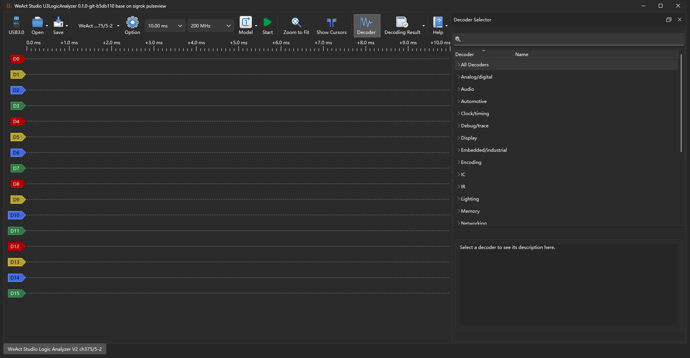

# CH32H417 Logic Analyzer - PC software

[中文文档](README_zh_CN.md)

**U3LogicAnalyzer** is the host application for the WeAct Studio CH32H417 logic analyzer.
It is based on sigrok PulseView and ships 132 protocol decoders (I²C, SPI, UART, ...).
The hardware drivers are trimmed to the two that belong to this device, plus PulseView's
`demo` driver and the `fx2lafw` driver for FX2 based analyzers. Everything is built by CMake
through one script.



## Quick start

```bash
# Windows (MSYS2 MINGW64)
./setup_env.sh
./build.sh
./start_pv.sh

# Linux (Debian / Ubuntu)
./setup_env_linux.sh
sudo ./install_udev_rules.sh      # open the device without root (once)
./build.sh
./start_pv.sh
```

## Documentation

| Document | Contents |
|---|---|
| [doc/usage.md](doc/usage.md) | Connecting a board, capturing, device options, reading the waveform, protocol decoders, saving and exporting, sessions, firmware update, troubleshooting |
| [doc/building.md](doc/building.md) | Dependencies, building on Windows and Linux, running from the build tree, packaging, udev rules, FX2 firmware, adding a driver, build problems |

中文文档：[使用说明](doc/usage.zh_CN.md) · [构建说明](doc/building.zh_CN.md)

## Platforms

| Platform | State | How the dependencies are installed |
|---|---|---|
| Windows 10/11 + MSYS2 MINGW64 | supported | `./setup_env.sh` |
| Linux (Debian / Ubuntu) | supported | `./setup_env_linux.sh` (apt) |
| macOS | **not ported** | none (`setup_env_macos.sh` is kept but no longer maintained) |

## Device access and driver back ends

| | Windows | Linux | macOS |
|---|---|---|---|
| `wch-ch32h417` (CH375DLL) | yes, the default binding | not built | not built |
| `wch-ch32h417-libusb` (libusb) | yes, after rebinding to WinUSB with Zadig | yes | unverified |
| `fx2lafw` (libusb, FX2 based analyzers) | yes, after rebinding to WinUSB with Zadig | yes | unverified |
| Firmware upgrade (IAP) | either back end | libusb only | unverified |

On Windows the device is bound to `CH375WDM.sys` by default, which is what the `wch-ch32h417`
driver talks to; the libusb back end there needs a WinUSB rebind with Zadig first. Off Windows
only the libusb back end exists. Of the two, Linux has been built and run; macOS has not been ported.

## Layout

```
.
├── doc/                         # usage and build documentation (EN / zh_CN) with screenshots
├── setup_env.sh                 # environment setup, Windows
├── setup_env_linux.sh           # environment setup, Debian/Ubuntu
├── setup_env_macos.sh           # environment setup, macOS (kept, not ported)
├── build.sh                     # build + portable package
├── package_installer.sh         # installer (NSIS / deb + tar.gz + AppImage)
├── install_udev_rules.sh        # installs the udev rules on Linux
├── start_pv.sh                  # start with the environment set (-l 5)
├── install/                     # libsigrok / libsigrokcxx / libsigrokdecode
├── libsigrok/src/hardware/
│   ├── wch-ch32h417/            # CH375 back end (Windows only)
│   ├── wch-ch32h417-libusb/     # libusb back end (all platforms)
│   ├── fx2lafw/                 # FX2 based analyzers
│   └── demo/
├── libsigrokdecode/decoders/    # the 132 protocol decoders
├── pulseview/                   # application (OUTPUT_NAME=U3LogicAnalyzer)
└── build_cmake/logicanalyzer_build/
```

## Origin

This software is a modification of the project of **Q2H2**. The CH375 driver
(`libsigrok/src/hardware/wch-ch32h417/`), the `demo` driver and the parts of libsigrok /
libsigrokdecode that were left alone still carry their `Copyright (C) 2026 Q2H2` notice, which
this project did not touch. The libusb driver added here (`wch-ch32h417-libusb/`) is copyright
WeAct Studio. The `fx2lafw` driver (`libsigrok/src/hardware/fx2lafw/`) is upstream sigrok code and
keeps the notice of its authors, Bert Vermeulen and Joel Holdsworth.

## License

GPL-2.0-or-later, see [LICENSE](LICENSE).
