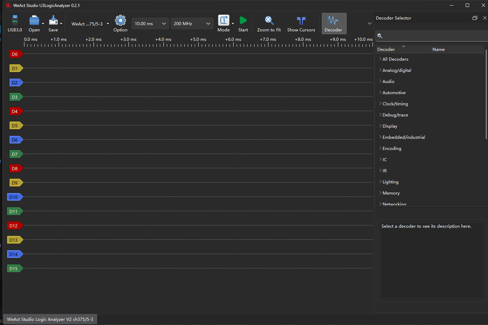

# CH32H417 Logic Analyzer - PC software

[中文文档](README_zh_CN.md)

**U3LogicAnalyzer** is the host application for the WeAct Studio CH32H417 logic analyzer.
It is based on sigrok PulseView and ships 132 protocol decoders (I²C, SPI, UART, ...).
The hardware drivers are trimmed to the two that belong to this device, plus PulseView's
`demo` driver and the `fx2lafw` driver for FX2 based analyzers. Everything is built by CMake
through one script.



## Quick start

```bash
# Windows (MSYS2 MINGW64)
./setup_env.sh
./build.sh
./start_pv.sh

# Linux (Debian / Ubuntu)
./setup_env_linux.sh
sudo ./install_udev_rules.sh      # open the device without root (once)
./build.sh
./start_pv.sh

# macOS 13 or newer (Homebrew, Qt 6)
./setup_env_macos.sh
./build.sh
./start_pv.sh
```

## Documentation

| Document | Contents |
|---|---|
| [doc/usage.md](doc/usage.md) | Connecting a board, capturing, device options, reading the waveform, protocol decoders, saving and exporting, sessions, firmware update, agent setup, troubleshooting. The installer also carries both PDFs ([English](doc/U3LogicAnalyzer-UsageGuide.pdf) / [中文](doc/U3LogicAnalyzer-UsageGuide.zh_CN.pdf)), opened from Help → User Guide |
| [doc/building.md](doc/building.md) | Dependencies, building on Windows, Linux and macOS, running from the build tree, packaging (including the dmg), udev rules, FX2 firmware, adding a driver, build problems |
| [doc/mcp-server.md](doc/mcp-server.md) | Client configuration, tool list, typical workflow, troubleshooting |

中文文档：[使用说明](doc/usage.zh_CN.md) · [构建说明](doc/building.zh_CN.md)

## Platforms

| Platform | State | How the dependencies are installed |
|---|---|---|
| Windows 10/11 + MSYS2 MINGW64 | supported | `./setup_env.sh` |
| Linux (Debian / Ubuntu) | supported | `./setup_env_linux.sh` (apt) |
| macOS 13 or newer | supported (tested on Apple Silicon hardware; Intel Macs build but are untested) | `./setup_env_macos.sh` (Homebrew, Qt 6) |

## Device access and driver back ends

| | Windows | Linux | macOS |
|---|---|---|---|
| `wch-ch32h417` (CH375DLL) | yes, the default binding | not built | not built |
| `wch-ch32h417-libusb` (libusb) | uninstall the device and delete its driver, then automatic from firmware 0.2; Zadig for older firmware | yes | yes, no driver needed |
| `fx2lafw` (libusb, FX2 based analyzers) | yes, after rebinding to WinUSB with Zadig | yes | unverified |
| Firmware upgrade (IAP) | either back end | libusb only | libusb only |

On Windows the device is bound to `CH375WDM.sys` when the CH375 driver is installed, which is what
the `wch-ch32h417` driver talks to. To use WinUSB instead, uninstall the device in Device Manager
with "Delete the driver software for this device" checked, then replug: firmware 0.2 binds WinUSB
automatically. Older firmware and FX2-based analyzers still need a WinUSB rebind with Zadig. Off
Windows only the libusb back end exists and no driver has to be installed: Linux takes access
through udev rules, macOS uses the USB interfaces the system already provides.

All three platforms have been tested with the hardware. The macOS build is distributed as a dmg
with a minimum of macOS 13.0; it is installed by dragging the application into "Applications", and
since it is not notarised the first launch needs right-click → Open. The interface language follows
the system, and so does the application name in the menu bar and in the application menu, while the
Dock tooltip and the `.app` file on disk stay `U3LogicAnalyzer`.

## The u3logicanalyzer-cli command line tool

The packages ship `u3logicanalyzer-cli` for scripts and AI agents. It links the same
libsigrok, uses the same protocol decoders and the same FX2 firmware as the application, so devices
and decoders behave identically. The full name keeps it apart from a `sigrok-cli` that came with the
distribution or that the user built.

| Platform | Location |
|---|---|
| Windows | `C:\Program Files\WeAct Studio\U3LogicAnalyzer\u3logicanalyzer-cli.exe` |
| Linux (deb / tar.gz) | `/opt/U3LogicAnalyzer/u3logicanalyzer-cli` |
| Linux (AppImage) | `usr/bin/u3logicanalyzer-cli` inside the mounted image |
| macOS | `/Applications/U3LogicAnalyzer.app/Contents/MacOS/u3logicanalyzer-cli` |

The tool locates its decoders, firmware and libraries relative to its own directory, so no
environment variables are needed; call it by absolute path. For example:

```bash
u3logicanalyzer-cli --scan
u3logicanalyzer-cli -d wch-ch32h417:conn=/1.3 \
           --config samplerate=4m:voltage_threshold=1.2 --samples 10m \
           -C D0,D1 -P uart:rx=D0:baudrate=115200 -A uart=rx-data
```

Several `--config` options are joined with `:`. An option of a range type (`voltage_threshold` is
one) takes `low-high`; a single number is rejected. The value is the level on the pins, 0.60 V to
1.50 V on this board.

On macOS the program carries the ad-hoc signature of the application and is not notarised. Launch
the application once (right-click → Open) before calling it from a script, so the system's origin
check does not block it.

The sources are in `cli/` and `build.sh` compiles it together with the application against
the same libsigrok, so no separate toolchain or prebuilt binary is involved.

### For AI clients

The package also ships `u3logicanalyzer-mcp-server`, an MCP server in the same directory. Configure
it in any MCP capable client and an agent can scan, capture and decode in natural language. Protocol
and tools follow KenosInc/sigrok-mcp-server; see [MCP Server](doc/mcp-server.md).

How to install, configure and verify both components is in the
[agent setup section](doc/usage.md) of the user guide; the same chapter ships as a PDF, opened
from Help → User Guide or from the last page of the installer.

## Layout

```
.
├── doc/                         # usage and build documentation (EN / zh_CN) with screenshots
├── setup_env.sh                 # environment setup, Windows
├── setup_env_linux.sh           # environment setup, Debian/Ubuntu
├── setup_env_macos.sh           # environment setup, macOS (Homebrew)
├── build.sh                     # build + portable package
├── package_installer.sh         # installer (NSIS / deb + tar.gz + AppImage / dmg)
├── packaging/macos/             # dmg layout, background image and the script that draws it
├── install_udev_rules.sh        # installs the udev rules on Linux
├── start_pv.sh                  # start with the environment set (-l 5)
├── install/                     # libsigrok / libsigrokcxx / libsigrokdecode
├── libsigrok/src/hardware/
│   ├── wch-ch32h417/            # CH375 back end (Windows only)
│   ├── wch-ch32h417-libusb/     # libusb back end (all platforms)
│   ├── fx2lafw/                 # FX2 based analyzers
│   └── demo/
├── libsigrokdecode/decoders/    # the 132 protocol decoders
├── cli/                         # the command line tool shipped for scripts and agents
├── mcp_server/                  # the MCP server, built with the rest
├── pulseview/                   # application (OUTPUT_NAME=U3LogicAnalyzer)
└── build_cmake/logicanalyzer_build/
```

## Origin

This software is a modification of the project of **Q2H2**. Files inherited from that project keep
their `Copyright (C) 2026 Q2H2` notice; where this project changed one of them, `Copyright (C) 2026
WeAct Studio` is added below it. The libusb driver added here (`wch-ch32h417-libusb/`), the command
line tool (`cli/`), the MCP server (`mcp_server/`) and the dialogs added under
`pulseview/pv/dialogs/` are copyright WeAct Studio. The `fx2lafw` driver
(`libsigrok/src/hardware/fx2lafw/`) is upstream sigrok code and keeps the notice of its authors,
Bert Vermeulen and Joel Holdsworth; the changes made here are marked below that notice.

`cli/` comes from the upstream sigrok-cli project, through CH32H417-sigrok-cli. The changes are in
`main.c` (paths derived from the directory of the binary, option checks before a capture),
`session.c` (the format argument), `input.c` (a file no module recognised, no transform module on a
file) and `parsers.c` (empty fields in the option table). Licence and authorship are in the COPYING
and AUTHORS files of that directory.

## License

GPL-3.0-or-later, see [LICENSE](LICENSE).
