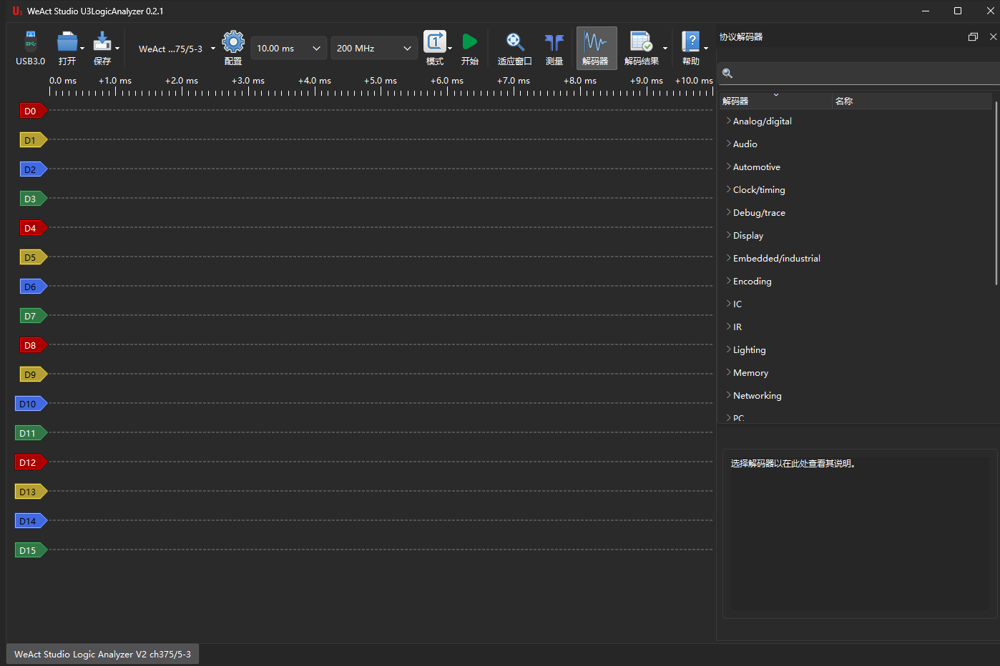

# CH32H417 逻辑分析仪 PC 软件

[English](README.md)

**U3LogicAnalyzer** 是 WeAct Studio CH32H417 逻辑分析仪的上位机软件，基于 sigrok PulseView，
自带 132 个协议解码器（I²C / SPI / UART 等）。硬件驱动裁剪到只剩本项目相关的两个，
另外保留 PulseView 的 `demo` 驱动与给 FX2 方案分析仪用的 `fx2lafw` 驱动，纯 CMake 一键构建。



## 快速开始

```bash
# Windows（MSYS2 MINGW64）
./setup_env.sh
./build.sh
./start_pv.sh

# Linux（Debian / Ubuntu）
./setup_env_linux.sh
sudo ./install_udev_rules.sh      # 免 root 打开设备（只需一次）
./build.sh
./start_pv.sh

# macOS 13 及以上（Homebrew，Qt 6）
./setup_env_macos.sh
./build.sh
./start_pv.sh
```

## 文档

| 文档 | 内容 |
|---|---|
| [使用说明](doc/usage.zh_CN.md) | 连接设备、设备选项、采集、看波形、协议解码、保存导出、多会话、固件升级、Agent 配置、常见问题。安装包内另带 PDF 版（[中文](doc/U3LogicAnalyzer-UsageGuide.zh_CN.pdf) / [English](doc/U3LogicAnalyzer-UsageGuide.pdf)），可从「帮助 → 使用说明」打开 |
| [构建说明](doc/building.zh_CN.md) | 依赖安装、Windows / Linux / macOS 构建、运行、打包（含 dmg）、udev 规则、FX2 固件、添加驱动、构建问题 |
| [MCP Server](doc/mcp-server.zh_CN.md) | AI 客户端配置、工具清单、典型流程、故障排查 |

English: [Usage](doc/usage.md) · [Building](doc/building.md)

## 平台支持

| 平台 | 状态 | 依赖安装 |
|---|---|---|
| Windows 10/11 + MSYS2 MINGW64 | 支持 | `./setup_env.sh` |
| Linux（Debian / Ubuntu） | 支持 | `./setup_env_linux.sh`（apt） |
| macOS 13 及以上 | 支持（Apple Silicon 已真机验证；Intel 机型可构建，未实测） | `./setup_env_macos.sh`（Homebrew，Qt 6） |

## 设备访问与驱动后端

| | Windows | Linux | macOS |
|---|---|---|---|
| `wch-ch32h417`（CH375DLL） | 默认绑定 | 不参与构建 | 不参与构建 |
| `wch-ch32h417-libusb`（libusb） | 需在设备管理器中卸载设备并删除驱动，固件 0.2 起重新插拔后自动绑定；旧固件需 Zadig | 支持 | 支持（无需驱动） |
| `fx2lafw`（libusb，FX2 方案设备） | 需先用 Zadig 改绑 WinUSB | 支持 | 未验证 |
| 固件升级（IAP） | 两个后端都行 | 仅 libusb 后端 | 仅 libusb 后端 |

Windows 上已安装 CH375 驱动时设备绑在 `CH375WDM.sys`，走 `wch-ch32h417` 驱动。需要改用 WinUSB 时，在设备管理器中卸载设备并勾选「删除此设备的驱动程序软件」，重新插拔后固件 0.2 会自动绑定 WinUSB；更早版本的固件或 FX2 方案设备仍需用 Zadig 改绑。非 Windows 平台只有 libusb 后端，无需安装任何驱动：Linux 依靠 udev 规则取得权限，macOS 直接使用系统自带的 USB 接口。

三个平台均已在真机上验证。macOS 版本以 dmg 分发，最低系统版本为 13.0；安装方式是把应用拖入「应用程序」文件夹，未做公证签名，首次启动需右键选择「打开」。界面语言跟随系统，菜单栏与应用菜单中的应用名也随之本地化；程序坞的悬停提示与磁盘上的 `.app` 文件名固定为 `U3LogicAnalyzer`。

## 命令行工具 u3logicanalyzer-cli

安装包内附带 `u3logicanalyzer-cli`，用于脚本与 AI Agent 调用：它与图形界面共享同一份
libsigrok、协议解码器和 FX2 固件，因此支持的设备、解码器和界面完全一致。程序使用全称而不叫
`sigrok-cli`，以免与发行版或用户自己安装的同名工具混淆。

| 平台 | 位置 |
|---|---|
| Windows | `C:\Program Files\WeAct Studio\U3LogicAnalyzer\u3logicanalyzer-cli.exe` |
| Linux（deb / tar.gz） | `/opt/U3LogicAnalyzer/u3logicanalyzer-cli` |
| Linux（AppImage） | `usr/bin/u3logicanalyzer-cli`（挂载目录内） |
| macOS | `/Applications/U3LogicAnalyzer.app/Contents/MacOS/u3logicanalyzer-cli` |

程序按自身所在目录查找解码器、固件与运行库，不需要设置 `SIGROKDECODE_DIR`、`SIGROK_FIRMWARE_DIR`、
`LD_LIBRARY_PATH` 等环境变量，直接以绝对路径调用即可。例如：

```bash
u3logicanalyzer-cli --scan
u3logicanalyzer-cli -d wch-ch32h417:conn=/1.3 \
           --config samplerate=4m:voltage_threshold=1.2 --samples 10m \
           -C D0,D1 -P uart:rx=D0:baudrate=115200 -A uart=rx-data
```

`--config` 的多个选项之间用冒号分隔。区间类型的选项（`voltage_threshold` 属于此类）要求写成
`下限-上限`，只写一个数值会被判为非法；该值是引脚上的电压，本机范围为 0.60 V 至 1.50 V。

macOS 上该程序随应用一起做临时签名，未做公证。首次使用前先启动一次图形界面（右键选择「打开」），再让
脚本调用，可避免系统的来源校验拦截。

sigrok-cli 的源码位于 `cli/`，由 `build.sh` 与本程序一同编译，链接的是同一份 libsigrok，因此不
需要单独准备编译工具链或预编译二进制。

### 给 AI 客户端用

安装包里还带一个 MCP 服务器 `u3logicanalyzer-mcp-server`，安装位置与上面的命令行工具相同。把它填进
支持 MCP 的客户端，就可以用自然语言让 AI 扫描设备、采集、解码。协议与工具集参照
KenosInc/sigrok-mcp-server 实现，配置方法与工具清单见 [MCP Server](doc/mcp-server.zh_CN.md)。

命令行工具与 MCP 服务器的安装、配置与验证步骤写在[使用说明的「Agent 配置」一节](doc/usage.zh_CN.md)，
安装包内同一章也有 PDF 版，可从「帮助 → 使用说明」或安装向导的完成页打开。

## 目录结构

```
.
├── doc/                         # 使用说明与构建说明（中英双语，含截图）
├── setup_env.sh                 # Windows 环境部署
├── setup_env_linux.sh           # Linux（Debian/Ubuntu）环境部署
├── setup_env_macos.sh           # macOS 环境部署（Homebrew）
├── build.sh                     # 构建 + 便携包
├── package_installer.sh         # 安装包（NSIS / deb+tar.gz+AppImage / dmg）
├── packaging/macos/             # dmg 布局、背景图与其生成脚本
├── install_udev_rules.sh        # Linux udev 规则安装
├── start_pv.sh                  # 带环境变量启动（-l 5）
├── install/                     # libsigrok / libsigrokcxx / libsigrokdecode
├── libsigrok/src/hardware/
│   ├── wch-ch32h417/            # CH375 后端（仅 Windows）
│   ├── wch-ch32h417-libusb/     # libusb 后端（全平台）
│   ├── fx2lafw/                 # FX2 方案分析仪
│   └── demo/
├── libsigrokdecode/decoders/    # 132 个协议解码器
├── cli/                         # 命令行工具（随安装包分发，供脚本与 Agent 调用）
├── mcp_server/                  # MCP 服务器源码（同上，一起编译）
├── pulseview/                   # 主程序（CMakeLists 中 OUTPUT_NAME=U3LogicAnalyzer）
└── build_cmake/logicanalyzer_build/
```

## 来源

本软件是在 **Q2H2** 的项目上修改而来。承自该项目的文件保留 `Copyright (C) 2026 Q2H2` 声明；
本项目改动过的，在其下方加注 `Copyright (C) 2026 WeAct Studio`。新增的部分（libusb 驱动
`wch-ch32h417-libusb/`、命令行工具 `cli/`、MCP 服务 `mcp_server/` 以及 `pulseview/pv/dialogs/`
下新增的对话框）版权归 WeAct Studio；`fx2lafw` 驱动（`libsigrok/src/hardware/fx2lafw/`）取自
上游 sigrok，保留其作者 Bert Vermeulen 与 Joel Holdsworth 的署名，本项目的改动注在其下方。

`cli/` 取自上游 sigrok-cli 项目，其间经历 CH32H417-sigrok-cli。改动位于 `main.c`（按自身所在
目录设置解码器、固件与 Python 的运行期路径，采集前校验选项组合）、`session.c`（一处格式化参数）、
`input.c`（没有任何模块识别的文件、对文件不允许变换模块）与 `parsers.c`（选项表中的空字段）；
许可与署名见该目录下的 COPYING 与 AUTHORS。

## 许可

GPL-3.0-or-later，见 [LICENSE](LICENSE)。
