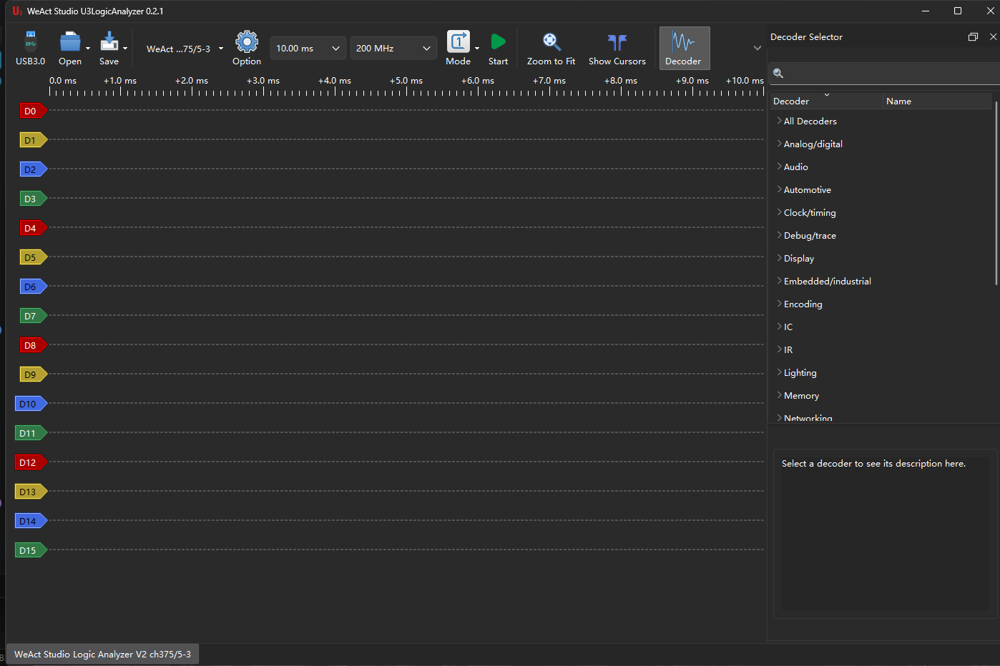
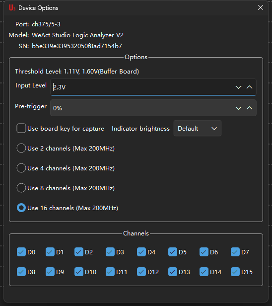
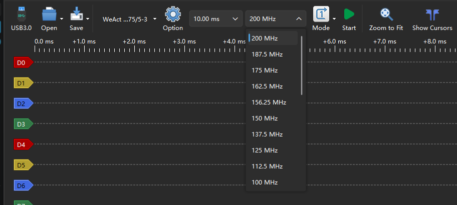
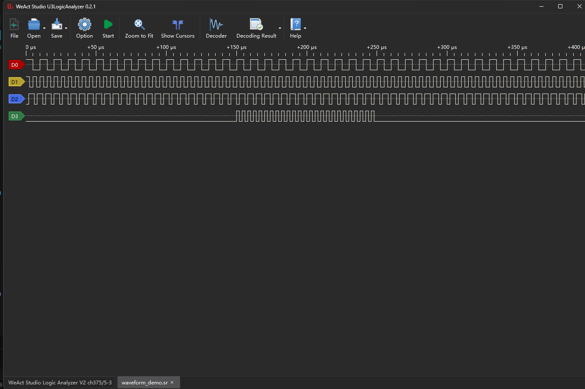
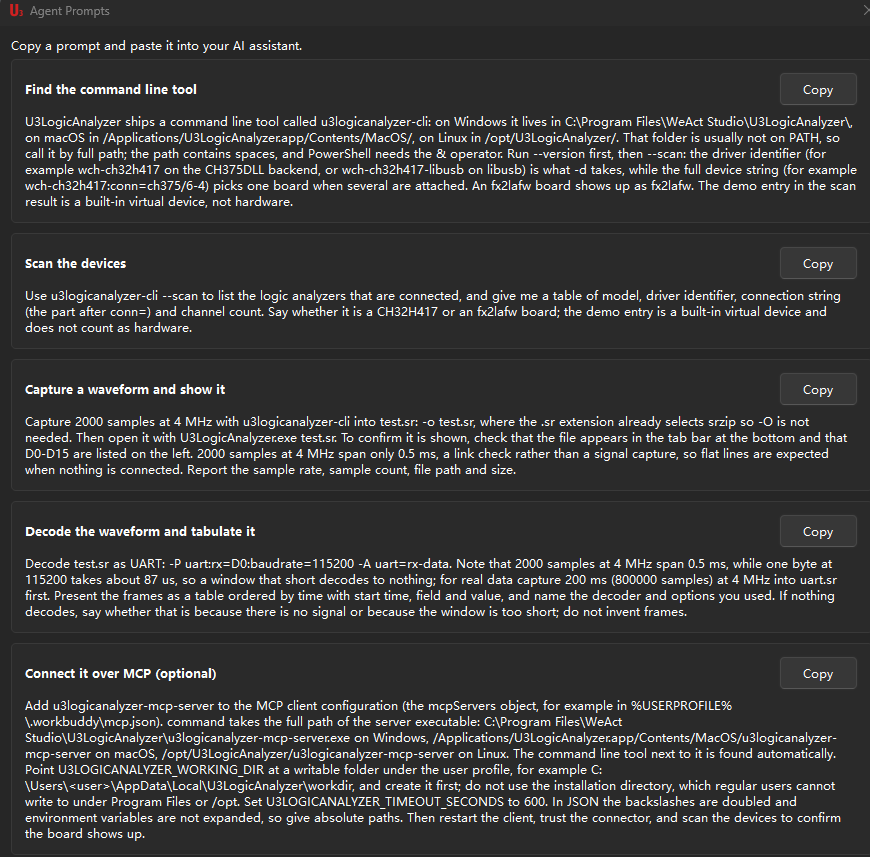

# Using U3LogicAnalyzer

[中文](usage.zh_CN.md) · [Back to README](../README.md)

This guide covers the everyday use of U3LogicAnalyzer: connecting a device, capturing, reading the waveform, adding protocol decoders and saving the result.



## Window layout

| Area | Contents |
|---|---|
| Tool bar | Open / Save (its drop-down carries the export formats) / device selector / device options / capture length / sample rate / capture mode / start / zoom to fit / measure / decoder / decoding result / help |
| Waveform view | One row per channel, channel labels on the left, time axis on top |
| Protocol decoder panel | Search box, decoder tree and the description of the selected decoder |
| Tab bar (bottom) | One tab per session: one device or one file |
| Status bar | Device name and connection id, e.g. `ch375/5-3` |

The interface follows the system language. To select one manually: Help → Settings → "User interface language"; the choice applies immediately.

## Connecting a device

The application scans for devices as soon as one is plugged in, and the device selector shows the model and port, e.g. `WeAct Studio Logic Analyzer V2 ch375/5-3`.

- **One device**: it is the only entry in the list; start capturing directly.
- **Several devices**: the list holds one row per port. Each row offers "open in a new session", so every device can capture into a session of its own at the same time.
- **Hot plug**: unplugging a capturing device leaves that page behind an offline mask, and no capture can be started there until the device is reconnected. Plugging or unplugging other devices during a capture does not affect the device being captured.

On Windows the CH375DLL driver is the default. To use WinUSB instead, uninstall the device in Device Manager with "Delete the driver software for this device" checked, then replug: firmware 0.2 (`sw=0x02` in the `0xAC` reply) binds WinUSB automatically. Older firmware and FX2-based analyzers still need a WinUSB rebind with Zadig.

On Linux, a device that `lsusb` lists but the application does not is a permission problem: run `sudo ./install_udev_rules.sh` and reconnect it.

macOS needs no driver and recognises the device as soon as it is plugged in. The package is a dmg: open it, drag the application into "Applications", then eject the disk image (⌘E). The application is not notarised, so the first launch has to be done by right-clicking the icon in Finder and choosing "Open".

## Device options

The device options button on the tool bar opens the device options panel:



| Item | Description |
|---|---|
| Threshold level | Range of the high/low decision; follows the input level |
| Input level | Voltage of the signal under test, 1.0–3.3 V. **It must match the level actually applied**: select 3.3 V for 3.3 V logic |
| Pre-trigger | Share of the capture window reserved for the time before the trigger (0–100%); see Capturing |
| Channel count | 2 / 4 / 8 / 16 channels. **With 8 channels** each sample takes one byte, so the same memory holds twice as many samples |
| Channel boxes | Channels that take part in the capture (affects display and decoding only; the data is still packed by channel count) |
| Indicator brightness | Five steps (Dim / Default / Bright / Brighter / Maximum). Remembered per device and restored when it is reconnected. V2 boards with firmware 0.2 and later only; older ones show no such row |
| Board key start/stop | Ticks the key on the board as a start/stop button: one short press starts a capture, another ends it; a two-second hold still switches slots. Remembered per device and restored when it is reconnected or the program is started again. **The change takes effect when this panel is closed**. V2 boards with firmware 0.2 and later only; older ones show no such row |

A wrong input level places the threshold incorrectly: set too high, genuine highs read as low; set too low, noise reads as high.

> Changing the channel count rebuilds the table of available sample rates. This reflects the device itself rather than an application defect: settle the channel count first, then select the rate.

## Sample rate and capture length

- **Sample rate**: 25 steps from 4 MHz to 200 MHz on a USB 3.0 link; the table follows the link and the channel count (4–20 MHz at 16 channels and 4–40 MHz at 8 channels on USB 2.0).
  
- **Capture length**: from 10 ms. The software uses an 18 GB data figure to define the length ceiling (samples = rate × time, 2 bytes per sample at 16 channels): about 45 s at 200 MHz / 16 channels, 90 s at 8 channels (the actual length is limited by free PC memory).

> 16 channels at 200 MHz produce 400 MB/s. Both Windows and Linux have been measured to capture continuously at that rate. On a Mac with Apple Silicon (M-series chip) this link carries 375 MB/s reliably: 16 channels at 187.5 MHz capture continuously, while 200 MHz stops about 40 ms after the start. On such a Mac, use 8 channels for 200 MHz or lower the rate to 187.5 MHz.

Rules of thumb:

| Use case | Rate | Duration |
|---|---|---|
| UART / I²C / SPI and other slow buses | At least 5× the baud rate or clock; 10–50 MHz is usual | Long enough for the message |
| Fast parallel buses | 100–200 MHz | As short as possible; keep memory use in view |
| Slow level changes | 4–10 MHz | A few seconds |

## Capturing

Press Start on the tool bar, or the space bar, to begin; press again to stop. When the capture ends, the view zooms to fit the data.

- **Mode → Single**: stops once the configured number of samples has been collected.
- **Mode → Repeat**: captures continuously until stopped; each round replaces the previous one.
- **Pre-trigger**: at 50%, half of the window holds samples from before the trigger and the rest samples after it. The device has no hardware trigger unit; the setting divides the capture window, which is what reveals the state preceding an event.
- **Long captures**: all data stays in memory. The application checks free memory while data arrives and stops the capture below 512 MB with a message, keeping the data already captured. Fewer channels, a lower rate or a shorter duration allow a longer capture.

## Reading the waveform

| Action | Procedure |
|---|---|
| Zoom the time axis | Scroll the mouse wheel over the waveform view, or use Zoom to Fit for the whole capture |
| Scroll | Drag the waveform, or use the scroll bar |
| Measure | The Measure button opens two cursors; drag them to read the time difference and frequency |
| Channel actions | Right-click a channel label to rename it, show or hide it, or change its height |
| Sample markers | The view options can draw sample points, which shows how dense the sampling is |

## Protocol decoders

The decoder button (or `D`) opens the panel on the right:

1. Type a protocol name into the search box, e.g. `uart`, `i2c` or `spi`.
2. Open a category, or double-click the decoder in the search results.
3. In the configuration dialog, assign the channels and set the options (the RX channel and baud rate for UART, for instance), then confirm.
4. The decoded rows appear below the waveform; Decoding Result switches to a list view of them.

A session can stack several decoders, for example SPI flash commands and data on one bus. There are 132 decoders; the full list is in the `decoders` folder of the installation directory (e.g. `C:\Program Files\WeAct Studio\U3LogicAnalyzer\decoders`).

Decoded results can be exported: the drop-down on the Save button writes several text formats, and "Export to a New Session" copies the waveform and its decoders into a new tab, which leaves the original capture unchanged.

## Saving and exporting

- **Save / Save As**: a sigrok session file (`.sr`, a zip container) holding channel data and the sample rate. An 8-channel capture stays 8 channels wide and is not read back as 16.
- **Save Selected Range As**: only the samples in the current view.
- **Save Session Setup**: the configuration only (device options, decoders, view), without data.
- **Open**: from the menu, or on the command line.

## Launcher options

These belong to the graphical program, `U3LogicAnalyzer`. The command line tool
`u3logicanalyzer-cli` has its own set, listed under agent setup below; options that share a
letter do not mean the same thing.

| Option | Meaning |
|---|---|
| `U3LogicAnalyzer file.sr` | Open a session file |
| `-i, --input-file <file>` | The same, naming the input explicitly |
| `-I, --input-format <format>` | Format of the input file, such as `srzip` or `vcd` |
| `-s, --settings <file>` | Load a saved session setup (layout, device options, decoders) |
| `-d, --driver <driver>` | Only use that driver; the values are the ones `--scan` reports, see agent setup below |
| `-D, --dont-scan` | Do not scan for devices at startup |
| `-c, --clean` | Start without restoring the session and settings of the last run |
| `-l, --loglevel <0-5>` | Log level, 5 is the most verbose |
| `-g, --debug` | Show the debug console window (Windows only) |
| `-h, -?, --help` / `-V, --version` | Help / version |

```bash
./U3LogicAnalyzer capture.sr            # Windows: U3LogicAnalyzer.exe capture.sr
./U3LogicAnalyzer -d fx2lafw -l 5       # only enumerate fx2 boards, with verbose logging
```

Opening a file builds the session from the channels it actually holds: only those channels get a row, and the channel dialog lists those alone.



## Sessions and multiple devices

- The tab bar at the bottom holds several sessions at once: one per device, or one per `.sr` file.
- The first session cannot be closed, and opening a file always adds a tab.
- "Export to a New Session" copies the result into a tab of its own; the capture it came from stays unchanged.
- Closing the last file tab restores the device session.

## Firmware update

Help menu → **FW Update**.

- The update runs over the device IAP. The tab cannot be closed while it runs, so an interrupted write still has a tab from which to retry.
- Progress is shown on the page; the device reconnects and is read again when the update finishes.
- Do not unplug the device during the write. A failed update can be retried while the device is still in IAP mode.
- A board that is already sitting in update mode (it shows up as a HID device in the operating system and no analyzer is available in the application) can still be written from the same menu item: the application finds boards in that state and writes them directly, without having to get the board back to normal operation first.

## Agent setup

The installer carries two command line components. Both are part of the product and are installed
with it, in the installation directory (default
`C:\Program Files\WeAct Studio\U3LogicAnalyzer`):

| Component | Program | Purpose |
|---|---|---|
| Command line tool | `u3logicanalyzer-cli` | Scan devices, capture, export and decode protocols without the GUI |
| MCP server | `u3logicanalyzer-mcp-server` | Exposes the same operations as tools for MCP-capable AI clients |

Both use the drivers, decoders and firmware in the installation directory, so no environment
variable is normally needed.

### Prompts built into the application (recommended)

**No configuration needed.** **Help → Agent Prompts** holds five prompts, one per task. Copy one
and paste it into the AI client: the text itself names the installation directory of the platform
it runs on, along with the usual options and the points that go wrong.



1. Choose **Help → Agent Prompts** in the application.
2. Pick the prompt for the task and press Copy.
3. Paste it into the AI client and send it.
4. Approve the command when the client asks. Most clients ask once before running an external
   program.

| Prompt | Used for | The client needs |
|---|---|---|
| Find the command line tool | Getting connected the first time: version and device list | Run commands |
| Scan the devices | Seeing which boards are attached, with driver and connection string | Run commands |
| Capture a waveform and show it | Taking a capture and opening it for a check | Run commands, read files |
| Decode the waveform and tabulate it | Decoding a protocol and presenting it as a table | Run commands, read files |
| Connect it over MCP (optional) | Exposing the analyzer to an MCP client | Editing the client configuration |

The first four need only the ability to run a local command and do not involve MCP. The fifth
turns the analyzer into MCP tools that the client calls by name, and is optional.

The sample rate, sample count and decoder options in the prompts are examples; change them before
pasting if the task needs other values. They are ordinary options of the command line tool, so the
prompt still runs.

> **The sections that follow are manual setup.** Read them only when you assemble the commands
> yourself, look up every option, or connect over MCP.

### Installation and working directory

The installation directory differs per platform:

| Platform | Directory |
|---|---|
| Windows | `C:\Program Files\WeAct Studio\U3LogicAnalyzer\` |
| Linux (deb / tar.gz) | `/opt/U3LogicAnalyzer/` |
| macOS | `/Applications/U3LogicAnalyzer.app/Contents/MacOS/` |

Create a working directory for captured data; files written without an output path land there.
Put it in the user profile — for example `C:\Users\<user>\AppData\Local\U3LogicAnalyzer\workdir`
on Windows and `~/U3LogicAnalyzer-workdir` on Linux and macOS — and create it beforehand. Do not
use a folder inside the installation directory: `Program Files` and `/opt` are read-only for
regular users.

On macOS the application also has to be launched once from the interface (right-click the icon
in Applications and choose Open). It is signed ad hoc and not notarised, so calling it directly
from a script can be blocked by the platform's origin check.

**The MCP server is optional.** Every step can be done with a single command line tool
invocation; configuring MCP only saves the AI client from assembling those commands itself.

### Calling the command line tool directly

An agent only needs to be able to run commands. When the installation directory is not on
`PATH`, call the program by its full path; the path contains spaces, so PowerShell needs the
call operator `&`:

```powershell
& "C:\Program Files\WeAct Studio\U3LogicAnalyzer\u3logicanalyzer-cli.exe" --scan
```

```bash
u3logicanalyzer-cli --scan
u3logicanalyzer-cli -d wch-ch32h417 -c samplerate=4m --samples 2000 -o capture.sr
u3logicanalyzer-cli -i capture.sr -P uart:rx=D0:baudrate=115200 -A uart=rx-data
```

Describe the task and let the agent assemble the command:

- "List the logic analyzers that are connected."
- "Capture 2000 samples at 4 MHz and save them to `test.sr`."
- "Decode `test.sr` as UART, RX on D0, 115200 baud."

### Options of the command line tool

| Option | Meaning |
|---|---|
| `--scan` | List devices together with the driver identifier and connection string, e.g. `wch-ch32h417:conn=ch375/4-2`. A WeAct CH32H417 reports `wch-ch32h417` (CH375DLL) or `wch-ch32h417-libusb`, an fx2lafw board reports `fx2lafw` |
| `-d` | Driver identifier, as returned by `--scan`. With several boards attached, pass the full connection string to pick one |
| `-c` | Device options, colon separated, e.g. `samplerate=4m:voltage_threshold=1.2-1.2`. `voltage_threshold` is a range and has to be written `low-high`; a single value is rejected |
| `--samples` / `--time` | Capture length in samples / in milliseconds. `--time` takes neither a negative value nor one that overflows the integer range |
| `--frames` | Number of frames to capture. It has to be used together with `--samples` or `--time`, which say how long a frame is; on its own the first frame never ends |
| `-o` | Output file. Without `-O` the extension picks the format: `.sr` for a session file (opened directly by the application), `.vcd`, `.csv`, `.bin`, `.txt`, `.hex`, `.json`, `.la8`, `.ols`, `.wav`. An extension none of those match is written as `.sr` |
| `-O` / `-I` | Output / input format, taking precedence over the extension. Do not pass `-I` for a `.sr` session file: the application loads it directly, while `-I` reads it as a plain input format |
| `-T` | Transform module, e.g. `invert`. It applies to a capture only and is refused together with `-i` |
| `-l` | Log level 0-5; a value outside that range is an error |
| `-P` / `-A` | Protocol decoder with its options / annotations to show. Annotations go to standard output, not into the file named by `-o` |

### Configuring the MCP server

Add an entry to the client MCP configuration file, with `command` pointing at
`u3logicanalyzer-mcp-server`. The server looks for the command line tool in its own directory,
so the installation directory does not have to be on `PATH`:

```json
{
  "mcpServers": {
    "u3logicanalyzer": {
      "command": "C:\\Program Files\\WeAct Studio\\U3LogicAnalyzer\\u3logicanalyzer-mcp-server.exe",
      "args": [],
      "env": {
        "U3LOGICANALYZER_TIMEOUT_SECONDS": "600",
        "U3LOGICANALYZER_WORKING_DIR": "C:\\Users\\<user>\\AppData\\Local\\U3LogicAnalyzer\\workdir"
      }
    }
  }
}
```

The example above uses the default Windows installation directory. The defaults are:

| Platform | Installation directory |
|---|---|
| Windows | `C:\Program Files\WeAct Studio\U3LogicAnalyzer\` |
| macOS | `/Applications/U3LogicAnalyzer.app/Contents/MacOS/` |
| Linux (deb / tar.gz) | `/opt/U3LogicAnalyzer/` |
| Linux (AppImage) | `usr/bin/` inside the mount point; run `--appimage-extract` first |

The directory named by `U3LOGICANALYZER_WORKING_DIR` has to be created beforehand and be
writable by the current user. The example points at the user profile; the installation
directory is read-only for regular users under `Program Files` and `/opt`.

Configuration file locations:

| Client | Path |
|---|---|
| WorkBuddy | `%USERPROFILE%\.workbuddy\mcp.json` (`~/.workbuddy/mcp.json` on macOS and Linux) |
| Claude Desktop | `%APPDATA%\Claude\claude_desktop_config.json` |
| Cursor | `%USERPROFILE%\.cursor\mcp.json` |

Create the file when it does not exist; otherwise merge the entry into `mcpServers` instead of
overwriting the other servers. Backslashes in Windows paths are written as `\\`. On macOS and
Linux only `command` changes, to the executable of that platform.

The server does not start on its own after saving: restart the client, open the connectors page,
enter "Custom connectors" from the top right corner, find `u3logicanalyzer` and click "Trust".

Configuration fields:

| Field | Meaning |
|---|---|
| `command` | Full path of `u3logicanalyzer-mcp-server` |
| `U3LOGICANALYZER_TIMEOUT_SECONDS` | Timeout of one call in seconds, 30 by default. Captures measured in seconds need a larger value, 600 is a sensible one |
| `U3LOGICANALYZER_WORKING_DIR` | Directory captures are written to when no output file is given; inherited from the client when omitted. It has to exist and be writable by the current user; do not point it at the installation directory, which is read-only for regular users under `Program Files` and `/opt`. Environment variables are not expanded inside the JSON, so give an absolute path |
| `U3LOGICANALYZER_CLI_PATH` | Location of the command line tool, by default its own directory; set it only to point elsewhere |

The interface and the tool list are documented in `doc/mcp-server.md` in the repository.

Once the configuration is active, verify it in this order:

1. "List the logic analyzers that are connected" — the answer names the model and port, e.g. `CH32H417 WeAct Studio Logic Analyzer V2`.
2. "Capture 2000 samples at 4 MHz and save them to `test.sr`" — 2000 samples at 4 MHz span 0.5 ms, enough to prove the link.
3. "Capture 1 s at 50 MHz into `D:\cap\uart.sr`", or "Decode `uart.sr` as UART, RX on D0, 115200 baud".

The MCP server covers device scanning, driver and decoder queries, capture, decoding, file
format queries and firmware checks. `capture_and_decode` merges capture and decode into one
call; `set_device_options` sends options without capturing, to confirm the device accepts them.
The full tool list is in `doc/mcp-server.md`.

## Troubleshooting

**The device is not in the device list**

- Windows: make sure no other program holds the device; switching to WinUSB requires uninstalling the device in Device Manager with "Delete the driver software for this device" checked. Older firmware and FX2-based devices also need a WinUSB rebind with Zadig.
- Linux: `lsusb` lists the device but the application does not. This is a permission problem: run `sudo ./install_udev_rules.sh` and reconnect the device. Inside a virtual machine, a device missing from `lsusb` altogether is usually not passed through: connect it to the virtual machine again, and restart the virtual machine if it still does not appear.
- macOS: no driver is needed. First check that the cable carries data and not only power. Look for `Logic Analyzer V2` under "System Information → Hardware → USB": on the USB 3.1 bus it is fine, while on the USB 2.0 bus the cable or adapter carries USB 2 only and the sample rate ceiling drops accordingly. A board that is in update mode does not appear under that name; write normal firmware to it with Help → FW Update.

**The capture stops at once with 0 samples**

- The sample rate exceeds what the link supports, or the sample count is too large. Lower the rate or shorten the duration and try again.
- On a Mac with Apple Silicon (M-series chip), 16 channels at 200 MHz need 400 MB/s, which is above the ceiling of that platform, and the capture fails the same way. Use 8 channels, or lower the rate to 187.5 MHz.
- The device may still be held by a previous program: unplug and reconnect it.

**The MCP server does not show up in the client**

- Check the configuration file name and path (`mcp.json`, no leading dot) and the JSON syntax; a stray or missing comma breaks parsing.
- Restart the client after saving, then trust the entry under Connectors → Custom connectors.

**An agent call fails**

- `u3logicanalyzer-cli could not be started` means the command line tool is not next to the MCP server; put them in the same directory or point `U3LOGICANALYZER_CLI_PATH` at it.
- A timeout needs a larger `U3LOGICANALYZER_TIMEOUT_SECONDS`; the 30 second default is too short for captures measured in seconds.

**A capture fails with invalid argument**

- The sample rate is not one the device supports. List them with `u3logicanalyzer-cli --show` or `show_driver_details`.

**The interface is in Chinese**

- The language was set to Chinese manually. Go to Help → Settings → "User interface language" and select English. On macOS the application name in the menu bar and in the Dock follows the system language and is independent of that setting.

**macOS refuses to open the application because the developer cannot be verified**

- The application is not notarised, so this is expected. Right-click the icon in Finder and choose "Open", or use "Open Anyway" under "System Settings → Privacy & Security". The confirmation is needed once.

**On macOS the disk image window does not close after the application has been dragged into "Applications"**

- The system performs no further action once the copy finishes. Eject the image manually, with the eject button next to the disk image in the Finder sidebar or with ⌘E.

**A low-memory notice appears at startup**

- The application checks free memory at startup and asks for confirmation below 4 GB. Close some programs or confirm to continue.
