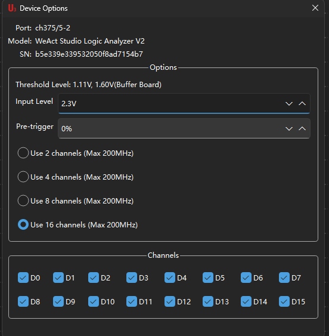
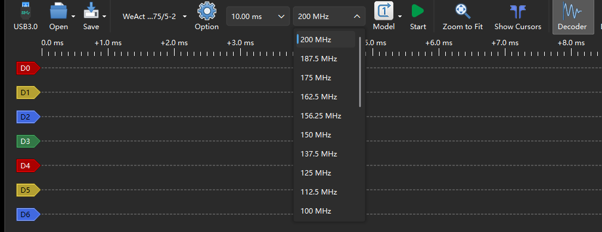
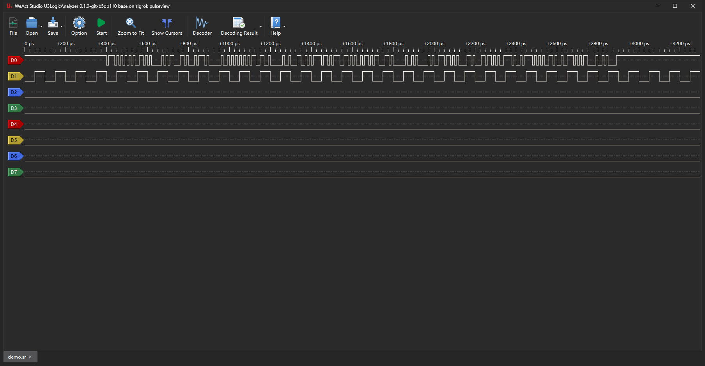

# Using the application

[中文](usage.zh_CN.md) · [Back to README](../README.md)

How to connect the analyzer, capture, read the waveform, decode a protocol and save the result.
Building and packaging are covered in [Building](building.md).


## Window layout

| Area | What is there |
|---|---|
| Tool bar | Open / Save / device selector / device options / sample count / sample rate / mode / start / zoom to fit / cursors / decoder / decoding result / export |
| Waveform view | One row per channel, channel labels on the left, time axis on top |
| Protocol decoder panel | Search box, decoder tree, description of the selected decoder |
| Tab bar (bottom) | One tab per session: a board or a file |
| Status bar | Device name and connection id, e.g. `ch375/5-2` |

The UI follows the system language. To pick one by hand: Help → Settings →
"User interface language". The choice applies immediately.

## Connecting a board

The device is scanned as soon as it is plugged in, and the device selector shows model and port,
e.g. `WeAct Studio Logic Analyzer V2 ch375/5-2`.

- **One board**: it is the only entry, just start capturing.
- **Several boards**: the list holds one row per port. Each row has "open in a new session" on
  the right, so every board can capture into a page of its own, at the same time.
- **Hot plug**: unplugging the board that is capturing leaves that page behind an offline mask -
  a capture cannot be started there until the board is back. Boards coming and going while a
  capture runs do not disturb it.

On Windows the CH375DLL driver is the default. To use the libusb back end instead (or an FX2
based analyzer), rebind the device to WinUSB with Zadig first - see the driver section of the README.

## Device options

The gear button opens Device Options:



| Item | Meaning |
|---|---|
| Threshold level | Range of the high/low decision, follows the input level |
| Input level | Voltage of the signal under test, 1.0-3.3 V. Pick 3.3 V for 3.3 V logic |
| Pre-trigger | Share of the capture window kept for the time before the trigger (0-100%) |
| Channels | 2 / 4 / 8 / 16 logic channels. **8 channels** store one byte per sample, so the same memory holds twice the samples |
| Channel boxes | Which channels take part in the capture (affects display and decoding; the data is still packed by channel count) |

> Changing the channel count rebuilds the sample rate table. That is a property of the device,
> not a bug: settle the channel count first, then pick the rate.

## Sample rate and sample count

- **Sample rate**: 16 steps from 4 MHz to 200 MHz, the steps follow the channel count.
  
- **Sample count** (the duration box): 10 ms to 10 s. Together with the rate it decides how many
  samples one capture holds (samples = rate × time, 2 bytes per sample at 16 channels).

Rules of thumb:

| What you look at | Rate | Duration |
|---|---|---|
| UART / I²C / SPI, slow buses | 5× the baud rate or clock, 10-50 MHz is usual | long enough for the message |
| Fast parallel buses | 100-200 MHz | as short as possible, watch the memory |
| Slow level changes | 4-10 MHz | seconds |

## Capturing

Press Start on the tool bar, or the space bar, and press it again to stop. When the capture ends
the view zooms to fit the data.

- **Mode → Single**: stops once the set number of samples is in.
- **Mode → Repeat**: captures continuously until stopped; each round replaces the previous one.
- **Pre-trigger**: at 50% half of the window holds the samples before the trigger, the rest after.
  The device has no hardware trigger unit - the setting divides the capture window, which is what
  you need to see the state a signal came from.
- **Long captures**: everything stays in memory. The application watches the free memory while the
  data comes in and stops the capture below 512 MB with a message, keeping what was captured.
  Fewer channels, a lower rate or a shorter run is what makes a longer capture fit.

## Reading the waveform

| Action | How |
|---|---|
| Zoom the time axis | Wheel over the view, or Zoom to Fit for the whole capture |
| Scroll | Drag the waveform, or use the scroll bar |
| Measure | Cursors shows two markers; drag them and read the time difference and frequency |
| Channel actions | Right click a channel label: rename, show/hide, change the height |
| Sampling points | The view options can draw them, which shows how dense the sampling is |

## Protocol decoders

The Decoder button (or `D`) opens the panel on the right:

1. Type a name into the search box, e.g. `uart`, `i2c`, `spi`.
2. Open a category, or double click the decoder in the search result.
3. In the dialog that follows, map the channels and set the options (RX channel and baud rate for
   UART, for instance), then confirm.
4. The decoded rows appear under the waveform; Decoding Result switches to a list view of them.

A session can stack several decoders - SPI flash commands and data on one bus, say. There are 132
of them, the full list is `libsigrokdecode/decoders/`.

Decoded results can be exported: the Export button writes several text formats, and
"Export to a New Session" copies the waveform and its decoders into a new tab so the original
capture stays untouched.

## Saving and exporting

- **Save / Save As**: a sigrok session file (`.sr`, a zip container) with the channel data and the
  sample rate. An 8 channel capture stays 8 channels wide and is not read back as 16.
- **Save Selected Range As**: only the samples in the current view.
- **Save Session Setup**: the configuration only (device options, decoders, view), no data.
- **Open**: from the menu, or on the command line:

```bash
./U3LogicAnalyzer capture.sr        # Windows: U3LogicAnalyzer.exe capture.sr
./U3LogicAnalyzer -i capture.sr
```

A file brings the channels it actually holds: those are the ones given a row, and the channel
popup lists them alone.



## Sessions and several devices

- The tab bar at the bottom holds several sessions at once: one per board, or one per `.sr` file.
- The first session cannot be closed, and opening a file always adds a tab.
- "Export to a New Session" copies the result into a tab of its own; the capture it came from is
  left as it was.
- Closing the last file tab brings the device session back.

## Firmware update

Help menu → **FW Update**.

- The update runs over the device IAP. The tab cannot be closed while it runs, so an interrupted
  write cannot leave the board stuck in its bootloader without a page to retry from.
- Progress is shown over the page; the device reconnects and is read again when it is done.
- Do not unplug during the write. If it fails, retry - the board is still in IAP mode.

## Troubleshooting

**The board is not in the device list**
- Windows: make sure no other program holds it; the libusb back end needs a WinUSB rebind with
  Zadig first.
- Linux: `lsusb` lists it but the application does not - that is a permission problem. Run
  `sudo ./install_udev_rules.sh` and replug.

**The capture stops at once with 0 samples**
- The sample rate is beyond what the link carries, or the sample count is too large. Lower the
  rate or shorten the duration and try again.
- The board may still be held by a previous program: unplug and replug it.

**The UI is in a language I did not pick**
- Help → Settings → "User interface language" and pick the one you want.

**A low memory notice appears at startup**
- The application checks the free memory before it starts and asks for confirmation below 4 GB.
  Close something, or just confirm.
