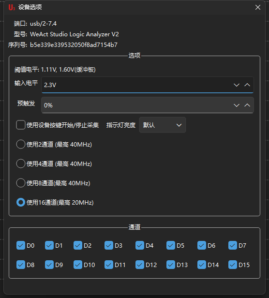
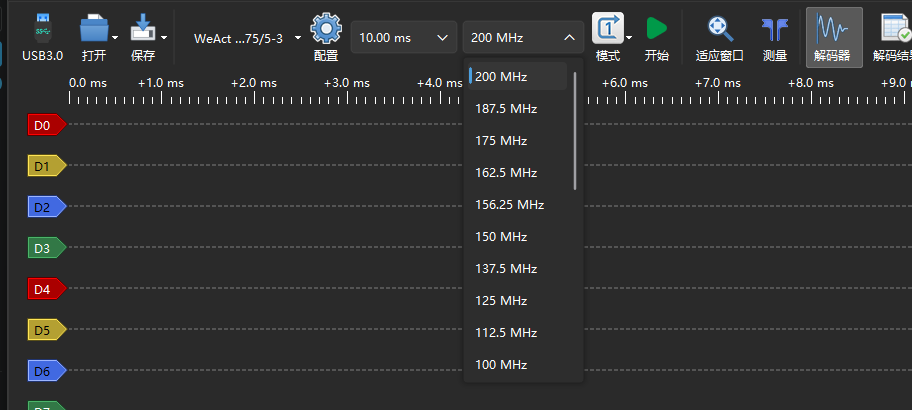
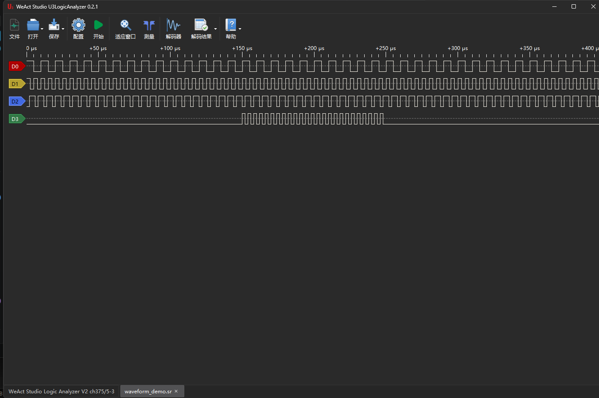

# U3LogicAnalyzer 使用说明

[English](usage.md) · [返回 README](../README_zh_CN.md)

本文说明 U3LogicAnalyzer 的日常操作，包括连接设备、采集、查看波形、添加协议解码与保存导出。


## 界面概览

| 区域 | 说明 |
|---|---|
| 顶部工具栏 | 打开 / 保存 / 设备选择 / 配置 / 采样时长 / 采样率 / 采集模式 / 开始 / 适应窗口 / 测量 / 解码器 / 解码结果 / 导出 |
| 左侧波形区 | 每行一个通道，左端为通道标签（可右键操作），上方为时间轴 |
| 右侧协议解码器 | 搜索框、解码器分类树与所选解码器的说明 |
| 底部标签栏 | 每个标签是一个独立会话（一台设备或一个文件） |
| 状态栏 | 设备名与连接编号，如 `ch375/5-2` |

界面语言跟随系统设置。手动切换方式：帮助 → 设置 → 「语言」，选中后立即生效。

## 连接设备

插上分析仪后，程序会自动扫描设备，设备选择器显示型号与端口，如 `WeAct Studio Logic Analyzer V2 ch375/5-2`。

- **单台设备**：下拉列表中仅有该项，可直接开始采集。
- **多台设备**：下拉列表按端口列出每一台设备；每行右侧提供「在新会话中打开」，可为每台设备各开一个会话并同时采集。
- **插拔**：拔掉正在采集的设备后，该页面显示离线遮罩，无法启动采集；重新插入后自动恢复。采集期间其他设备的插拔不影响正在采集的这台设备。

Windows 上默认使用 CH375DLL 驱动。需要改用 WinUSB 时，在设备管理器中卸载设备并勾选「删除此设备的驱动程序软件」，重新插拔后固件 0.2（`0xAC` 应答中 `sw=0x02`）会自动绑定 WinUSB；旧版固件或 FX2 方案的设备仍需用 Zadig 改绑。

Linux 上设备可见但软件中不出现时，属于权限问题，执行 `sudo ./install_udev_rules.sh` 后重新插拔。

macOS 不需要安装驱动，接入后即可识别。安装包为 dmg：打开后把应用拖入「应用程序」文件夹，然后推出磁盘映像（⌘E）。应用未做公证签名，首次启动需在 Finder 中右键点按图标并选择「打开」。

## 设备选项

点工具栏的「配置」（齿轮）按钮打开设备选项面板：



| 项目 | 说明 |
|---|---|
| 阈值电平 | 判定高低电平的门限范围，随「输入电平」联动 |
| 输入电平 | 被测信号的电压，1.0–3.3 V 可选。**必须与实际接入的信号电平一致**：接入 3.3 V 逻辑时选择 3.3 V |
| 预触发 | 采集窗口中留给触发前的比例（0–100%），详见「采集」一节 |
| 通道数 | 2 / 4 / 8 / 16 路。**8 通道**时每个采样点只占 1 字节，同样内存可存双倍采样点 |
| 通道 | 勾选参与采集的通道（仅影响显示与解码，数据仍按通道数打包） |
| 指示灯亮度 | 五档可选（暗 / 默认 / 较亮 / 亮 / 最亮）。选择按设备记忆，重新连接后自动恢复 |
| 使用设备按键开始/停止采集 | 勾选后板载按键可起停采集：短按一次开始，再短按一次结束；长按两秒仍用于切换槽位。**勾选在关闭本面板后生效** |

输入电平设置错误会使阈值落在错误位置：设置偏高时正常的高电平被判为低电平，设置偏低时噪声被判为高电平。

> 更改通道数会重置可选采样率表。这是设备侧的规格限制，并非程序缺陷。应先确定通道数，再选择采样率。

## 采样率与采样时长

- **采样率**：USB 3.0 下为 4 MHz 至 200 MHz，共 25 档，档位随链路与通道数变化（USB 2.0 时 16 通道 4 MHz 至 20 MHz，8 通道 4 MHz 至 40 MHz）。
  
- **采样时长**：10 ms 起。软件按 18 GB 数据量定义时长上限（采样点数 = 采样率 × 时长，16 通道每点 2 字节）：200 MHz / 16 通道约 45 s，8 通道约 90 s（实际时长受电脑可用内存限制）。

> 16 通道 200 MHz 的码率为 400 MB/s。Windows 与 Linux 均已实测可连续采集；在配备 Apple Silicon（M 系列芯片）的 Mac 上，该链路实测可稳定承载 375 MB/s，16 通道 187.5 MHz 可连续采集，200 MHz 则在开始后约 40 ms 中断。在 Apple Silicon 机型上需要 200 MHz 时请改用 8 通道，或将采样率降至 187.5 MHz。

选型参考：

| 场景 | 采样率 | 时长 |
|---|---|---|
| UART / I²C / SPI 等低速总线 | 不低于波特率或时钟的 5 倍，常用 10–50 MHz | 覆盖所需报文长度 |
| 高速并行总线 | 100–200 MHz | 尽量缩短，注意内存占用 |
| 观察慢速电平变化 | 4–10 MHz | 数秒 |

## 采集

按工具栏的「开始」（或空格键）开始采集，再次按下停止。采集完成后波形自动适应窗口。

- **模式 → 单次（Single）**：采集满设定的采样点数后停止。
- **模式 → 重复（Repeat）**：连续采集，直到手动停止；每轮覆盖上一轮数据。
- **预触发**：设为 50% 时，采集窗口的一半为触发前的样本，其余为触发后的样本。设备没有硬件触发单元，所谓触发是采集窗口内的比例划分，用于观察事件发生前的状态。
- **长采集保护**：数据全部驻留内存。程序在接收数据的过程中检查可用内存，低于 512 MB 时自动停止并提示，已采集的数据保留。需要更长采集时，可减少通道数、降低采样率或缩短时长。

## 波形操作

| 操作 | 方式 |
|---|---|
| 缩放时间轴 | 在波形区滚动鼠标滚轮；或点「适应窗口」回到全览 |
| 左右平移 | 拖动波形，或使用底部滚动条 |
| 测量 | 点「测量」按钮打开两条游标，拖动游标读取时间差与频率 |
| 通道操作 | 右键通道标签：重命名、显示或隐藏、调整高度 |
| 采样点标记 | 视图选项中可显示采样点，用于确认采样密度 |

## 协议解码

点工具栏「解码器」（或按 `D`）打开右侧面板：

1. 在搜索框输入协议名，如 `uart`、`i2c`、`spi`。
2. 展开分类，或直接从搜索结果中双击目标解码器。
3. 在随后弹出的配置窗口中指定通道与参数（如 UART 的 RX 通道、波特率），然后确认。
4. 解码结果作为新的行显示在波形下方；点「解码结果」可切换到单独的列表视图。

一个会话可以叠加多个解码器（例如在 SPI 总线上同时解析 flash 命令与数据）。解码器共 132 个，完整列表见安装目录下的 `decoders` 文件夹（如 `C:\Program Files\WeAct Studio\U3LogicAnalyzer\decoders`）。

解码结果可以导出：工具栏「导出」支持多种文本格式；「导出到新会话」会把当前波形与解码结果复制到新的标签页，便于对照或继续分析。

## 保存与导出

- **保存 / 另存为**：保存为 sigrok 会话文件（`.sr`，zip 容器），包含通道数据与采样率。8 通道采集保存后仍为 8 通道，不会按 16 通道读回。
- **保存选中范围**：只保存当前视口内的样本。
- **保存会话设置**：只保存配置（设备选项、解码器、视图），不含数据。
- **打开**：可通过菜单或命令行：

```bash
./U3LogicAnalyzer capture.sr        # Windows: U3LogicAnalyzer.exe capture.sr
./U3LogicAnalyzer -i capture.sr
```

打开文件时，会话按文件中实际存在的通道建立，通道弹窗只列出这些通道，不会出现空行。



## 多会话与多设备

- 底部标签栏可以同时打开多个会话：每台设备一个，或打开多个 `.sr` 文件。
- 第一个会话不可关闭；打开文件总是新开一个标签。
- 「导出到新会话」把当前结果复制为独立标签，原采集不受影响。
- 关闭最后一个文件标签后，程序会自动补回设备会话。

## 固件升级

帮助菜单 → **固件升级**（FW Update）。

- 升级通过设备 IAP 进行。升级期间该会话的标签不可关闭，避免中断导致设备停留在升级模式。
- 页面显示写入进度，完成后自动重连并重新读取设备信息。
- 升级期间不要拔线；中途失败可以重试，设备仍在 IAP 模式时再次升级即可。
- 板子已经停留在升级模式（在系统中显示为 HID 设备，软件中也没有可用的分析仪）时，同一菜单项仍然可用，程序会自动发现该状态的板子并直接写入，无需先让它退回正常工作模式。

## 常见问题

**设备列表中没有设备**
- Windows：确认设备未被其他程序占用；改用 WinUSB 需在设备管理器中卸载设备并勾选「删除此设备的驱动程序软件」。旧版固件或 FX2 方案的设备还需用 Zadig 改绑。
- Linux：`lsusb` 能看到设备但软件中没有，属于权限问题，执行 `sudo ./install_udev_rules.sh` 后重新插拔。在虚拟机中运行时，若 `lsusb` 完全没有该设备，通常是设备未直通给虚拟机：在虚拟机软件中重新连接该设备，仍不出现时重启虚拟机。
- macOS：无需驱动。先确认线缆支持数据传输。在「系统信息 → 硬件 → USB」中查找 `Logic Analyzer V2`：出现在「USB 3.1 总线」下即为正常；若出现在「USB 2.0 总线」下，说明线缆或转接头仅有 USB 2 通道，采样率上限会相应降低。板子停留在升级模式时不会以该名称出现，此时用「帮助 → 固件升级」写入正常固件即可。

**采集启动后立即停止、采样数为 0**
- 采样率超出当前链路能力，或采样点数过大。降低采样率或缩短时长后重试。
- 在 Apple Silicon（M 系列芯片）的 Mac 上，16 通道 200 MHz 需要 400 MB/s，超出该平台的链路上限（同配置下 187.5 MHz 可以正常采集），会出现同样的现象。改用 8 通道，或将采样率降至 187.5 MHz。
- 设备可能仍被先前的程序占用，拔下后重新连接即可。

**界面语言为英文**
- 界面语言已被手动设置为 English。帮助 → 设置 → 语言，选择「中文」。macOS 上菜单栏与程序坞显示的应用名跟随系统语言，与程序内的语言设置相互独立。

**macOS 提示「无法打开，因为无法验证开发者」**
- 应用未做公证签名，属于正常提示。在 Finder 中右键点按应用图标并选择「打开」，或在「系统设置 → 隐私与安全性」中点「仍要打开」。只需确认一次。

**macOS 中把应用拖入「应用程序」后，磁盘映像窗口不会自动关闭**
- 系统不会在拷贝完成后执行任何后续动作，需要手动推出：在 Finder 侧边栏点该磁盘映像右侧的推出按钮，或按 ⌘E。

**提示可用内存不足 4 GB**
- 程序启动时检查可用内存，低于 4 GB 时提示确认。关闭其他程序后重试，或直接确认继续。
