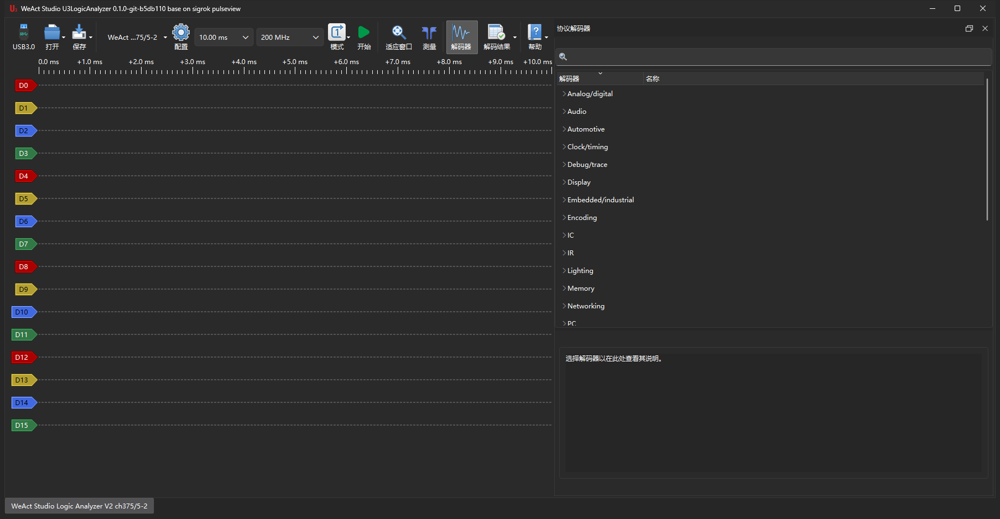
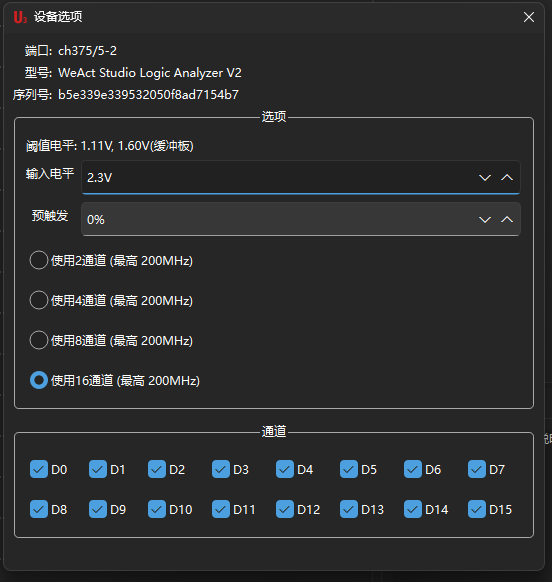
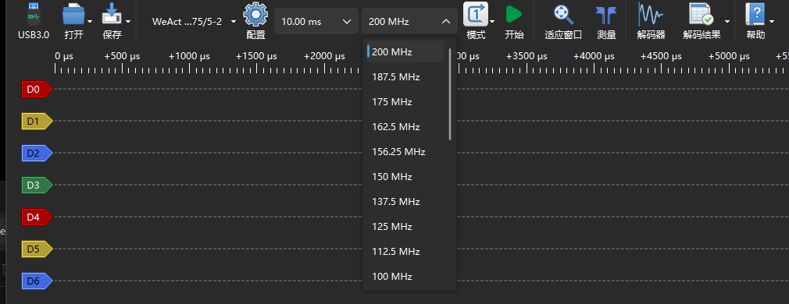
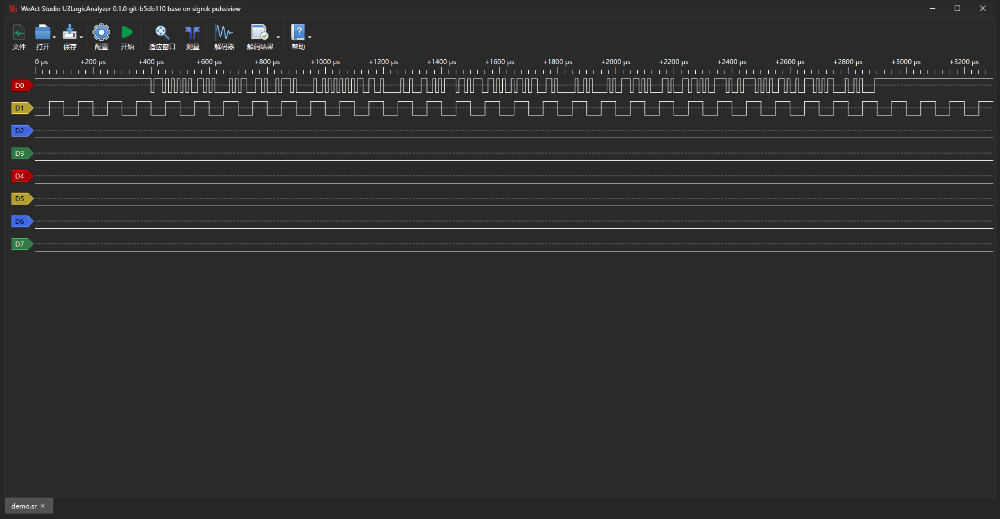

# 使用说明

[English](usage.md) · [返回 README](../README_zh_CN.md)

本文说明 U3LogicAnalyzer 的日常操作：接设备、采集、看波形、加协议解码、保存导出。
构建与打包见 [构建说明](building.zh_CN.md)。



## 界面概览

| 区域 | 说明 |
|---|---|
| 顶部工具栏 | 打开 / 保存 / 设备选择 / 设备选项 / 采样时长 / 采样率 / 采集模式 / 开始 / 适应窗口 / 测量 / 解码器 / 解码结果 / 导出 |
| 左侧波形区 | 每行一个通道，左端是通道标签（可右键操作），上方是时间轴 |
| 右侧协议解码器 | 搜索框 + 解码器分类树 + 选中解码器的说明 |
| 底部标签栏 | 每个标签是一个独立会话（一块板或一个文件） |
| 状态栏 | 设备名与连接编号，如 `ch375/5-2` |

界面语言跟随系统。想手动切换：帮助 → 设置 → 「语言」，选中后立即生效。

## 连接设备

插上分析仪后程序会自动扫描，设备选择器显示型号与端口，如 `WeAct Studio Logic Analyzer V2 ch375/5-2`。

- **一块板**：下拉里只有它，直接开始采即可。
- **多块板**：下拉按端口列出每一块；每行右侧有「在新会话中打开」，可以给每块板各开一个会话，同时采集。
- **插拔**：拔掉正在采集的板，该页会被离线遮罩盖住，采集不能启动；插回去自动恢复。
  采集期间别的设备进出不影响正在采集的这块板。

Windows 上默认走 CH375DLL 驱动。想改用 libusb 后端（或使用 FX2 方案的板），需要先用 Zadig
把设备改绑到 WinUSB，详见 README 的驱动一节。

## 设备选项

点工具栏的「配置」（齿轮）打开设备选项：



| 项 | 说明 |
|---|---|
| 阈值电平 | 判定高低电平的门限范围，随「输入电平」联动 |
| 输入电平 | 被测信号的电压，1.0–3.3 V 可选；接 3.3 V 逻辑就选 3.3 V |
| 预触发 | 采集窗口里留给触发前的比例（0–100%），见下文 |
| 通道数 | 2 / 4 / 8 / 16 路。**8 通道**每个采样只占 1 字节，同样内存能存双倍采样点 |
| 通道 | 勾选要参与采集的通道（只影响显示与解码，数据仍按通道数打包） |

> 改通道数会重置可选采样率表，这是设备侧的规格，不是 bug。先把通道数定下来，再选采样率。

## 采样率与采样时长

- **采样率**：USB 3.0 下 4 MHz 到 200 MHz 共 25 档，档位随链路与通道数变化
  （USB 2.0 时 16 通道 4 MHz 到 20 MHz、8 通道 4 MHz 到 40 MHz）。
  
- **采样时长**：10 ms 起，上限由电脑内存决定（点数 = 采样率 × 时长，16 通道每点 2 字节；
  软件按 18 GB 数据换算，200 MHz / 16 通道约 45 s，8 通道翻倍）。

选型参考：

| 场景 | 采样率 | 时长 |
|---|---|---|
| UART / I²C / SPI 等低速总线 | ≥ 5 倍波特率或时钟，常用 10–50 MHz | 覆盖你要的报文长度 |
| 高速并行总线 | 100–200 MHz | 尽量短，注意内存 |
| 观察慢速电平变化 | 4–10 MHz | 数秒 |

## 采集

按工具栏的「开始」（或空格键）开始，再按一次停止。采集完成后波形自动适应窗口。

- **模式 → 单次（Single）**：采满设定的采样点数就停。
- **模式 → 重复（Repeat）**：连续采集，直到手动停止；每次覆盖上一轮。
- **预触发**：设成 50% 时，采集窗口一半是"触发前"的样本，其余是之后的。
  设备没有硬件触发单元，所谓触发是采集窗口内的比例划分，用于让你看清事件发生前的状态。
- **长采集保护**：数据全部驻留内存。程序在收数过程中检查可用内存，低于 512 MB 时
  自动停止并提示；已采到的数据保留。想采更久就用更少通道、更低采样率或更短时长。

## 波形操作

| 操作 | 方式 |
|---|---|
| 缩放时间轴 | 在波形区滚轮；或点「适应窗口」回到全览 |
| 左右平移 | 拖动波形，或底部滚动条 |
| 测量 | 点「测量」打开游标，拖动两条游标读时间差与频率 |
| 通道操作 | 右键通道标签：重命名、显示/隐藏、调整高度 |
| 采样点标记 | 视图选项里可显示采样点，用于确认采样密度 |

## 协议解码

点工具栏「解码器」（或按 `D`）打开右侧面板：

1. 在搜索框输入协议名，如 `uart`、`i2c`、`spi`。
2. 展开分类或直接从搜索结果里双击目标解码器。
3. 在弹出的配置里指定通道与参数（如 UART 的 RX 通道、波特率），确定。
4. 解码结果作为新的行显示在波形下方；点「解码结果」可切到单独的列表视图。

一个会话可以叠多个解码器（例如 SPI 总线上同时解 flash 命令与数据）。解码器共 132 个，
完整列表见 `libsigrokdecode/decoders/`。

解码结果可以导出：工具栏「导出」支持多种文本格式；「导出到新会话」会把当前波形与解码
复制成新标签页，方便对照或继续分析。

## 保存与导出

- **保存 / 另存为**：写成 sigrok 会话文件（`.sr`，zip 容器），含通道数据与采样率。
  8 通道采集存下来就是 8 通道，不会被当成 16 通道读回。
- **保存选中范围**：只存当前视口内的样本。
- **保存会话设置**：只存配置（设备选项、解码器、视图），不含数据。
- **打开**：菜单或命令行都可以：

```bash
./U3LogicAnalyzer capture.sr        # Windows：U3LogicAnalyzer.exe capture.sr
./U3LogicAnalyzer -i capture.sr
```

打开文件时会话按文件里实际存在的通道建立，通道弹窗只列这些通道，不会留空行。



## 多会话与多设备

- 底部标签栏可以同时开多个会话：一块板一个、或打开多个 `.sr` 文件。
- 第一个会话不可关闭；打开文件总是新开一个标签。
- 「导出到新会话」把当前结果复制成独立标签，原采集不受影响。
- 关掉最后一个文件标签后，程序会自动补回设备会话。

## 固件升级

帮助菜单 → **固件升级**（FW Update）。

- 升级通过设备 IAP 进行，途中该会话的标签不可关闭（避免中断把板子留在升级态）。
- 页面上会显示写入进度，完成后自动重连并重新读取设备信息。
- 升级期间不要拔线；中途失败可以重试，设备仍在 IAP 模式时再次升级即可。

## 常见问题

**设备列表里没有板子**
- Windows：确认没被别的程序占用；用 libusb 后端时需先用 Zadig 改绑 WinUSB。
- Linux：`lsusb` 能看到但软件里没有 → 权限问题，执行 `sudo ./install_udev_rules.sh` 后重新插拔。

**采集一启动就停、采样数为 0**
- 采样率超出当前链路能力，或采样点数过大。降低采样率或缩短时长再试。
- 板子刚被别的程序占用过，拔插一次即可。

**界面全是英文**
- 语言被设成了 English。帮助 → 设置 → 语言，选「中文」。

**内存提示不足 4 GB**
- 程序启动时检查可用内存，低于 4 GB 会提示确认。关掉一些程序或直接确认继续。
