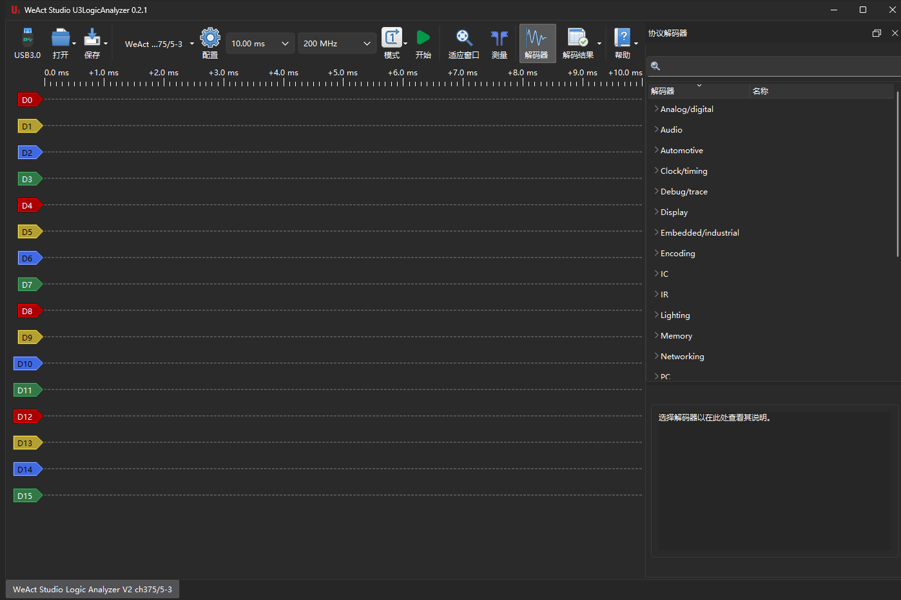
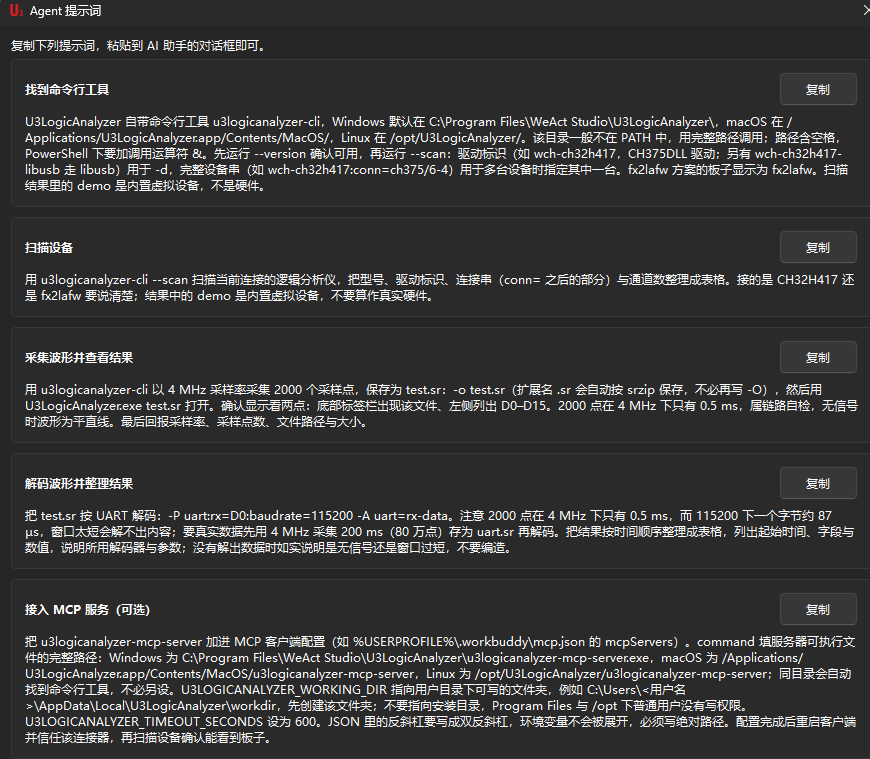

# U3LogicAnalyzer 使用说明

[English](usage.md) · [返回 README](../README_zh_CN.md)

本文说明 U3LogicAnalyzer 的日常操作，包括连接设备、采集、查看波形、添加协议解码与保存导出。



## 界面概览

| 区域 | 说明 |
|---|---|
| 顶部工具栏 | 打开 / 保存（下拉菜单含各种导出格式）/ 设备选择 / 配置 / 采样时长 / 采样率 / 采集模式 / 开始 / 适应窗口 / 测量 / 解码器 / 解码结果 / 帮助 |
| 左侧波形区 | 每行一个通道，左端为通道标签（可右键操作），上方为时间轴 |
| 右侧协议解码器 | 搜索框、解码器分类树与所选解码器的说明 |
| 底部标签栏 | 每个标签是一个独立会话（一台设备或一个文件） |
| 状态栏 | 设备名与连接编号，如 `ch375/5-3` |

界面语言跟随系统设置。手动切换方式：帮助 → 设置 → 「语言」，选中后立即生效。

## 连接设备

插上分析仪后，程序会自动扫描设备，设备选择器显示型号与端口，如 `WeAct Studio Logic Analyzer V2 ch375/5-3`。

- **单台设备**：下拉列表中仅有该项，可直接开始采集。
- **多台设备**：下拉列表按端口列出每一台设备；每行右侧提供「在新会话中打开」，可为每台设备各开一个会话并同时采集。
- **插拔**：拔掉正在采集的设备后，该页面显示离线遮罩，无法启动采集；重新插入后自动恢复。采集期间其他设备的插拔不影响正在采集的这台设备。

Windows 上默认使用 CH375DLL 驱动。需要改用 WinUSB 时，在设备管理器中卸载设备并勾选「删除此设备的驱动程序软件」，重新插拔后固件 0.2（`0xAC` 应答中 `sw=0x02`）会自动绑定 WinUSB；旧版固件或 FX2 方案的设备仍需用 Zadig 改绑。

Linux 上设备可见但软件中不出现时，属于权限问题，执行 `sudo ./install_udev_rules.sh` 后重新插拔。

macOS 不需要安装驱动，接入后即可识别。安装包为 dmg：打开后把应用拖入「应用程序」文件夹，然后推出磁盘映像（⌘E）。应用未做公证签名，首次启动需在 Finder 中右键点按图标并选择「打开」。

## 设备选项

点工具栏的「配置」按钮打开设备选项面板：


| 项目 | 说明 |
|---|---|
| 阈值电平 | 判定高低电平的门限范围，随「输入电平」联动 |
| 输入电平 | 被测信号的电压，1.0–3.3 V 可选。**必须与实际接入的信号电平一致**：接入 3.3 V 逻辑时选择 3.3 V |
| 预触发 | 采集窗口中留给触发前的比例（0–100%），详见「采集」一节 |
| 通道数 | 2 / 4 / 8 / 16 路。**8 通道**时每个采样点只占 1 字节，同样内存可存双倍采样点 |
| 通道 | 勾选参与采集的通道（仅影响显示与解码，数据仍按通道数打包） |
| 指示灯亮度 | 五档可选（暗 / 默认 / 较亮 / 亮 / 最亮）。选择按设备记忆，重新连接后自动恢复。仅 V2 硬件且固件 0.2 及以上支持，旧版不显示此项 |
| 使用设备按键开始/停止采集 | 勾选后板载按键可起停采集：短按一次开始，再短按一次结束；长按两秒仍用于切换槽位。选择按设备记忆，重新连接或重启软件后自动恢复。**勾选在关闭本面板后生效**。仅 V2 硬件且固件 0.2 及以上支持，旧版不显示此项 |

输入电平设置错误会使阈值落在错误位置：设置偏高时正常的高电平被判为低电平，设置偏低时噪声被判为高电平。

> 更改通道数会重置可选采样率表。这是设备侧的规格限制，并非程序缺陷。应先确定通道数，再选择采样率。

## 采样率与采样时长

- **采样率**：USB 3.0 下为 4 MHz 至 200 MHz，共 25 档，档位随链路与通道数变化（USB 2.0 时 16 通道 4 MHz 至 20 MHz，8 通道 4 MHz 至 40 MHz）。
  
- **采样时长**：10 ms 起。软件按 18 GB 数据量定义时长上限（采样点数 = 采样率 × 时长，16 通道每点 2 字节）：200 MHz / 16 通道约 45 s，8 通道约 90 s（实际时长受电脑可用内存限制）。

> 16 通道 200 MHz 的码率为 400 MB/s。Windows 与 Linux 均已实测可连续采集；在配备 Apple Silicon（M 系列芯片）的 Mac 上，该链路实测可稳定承载 375 MB/s，16 通道 187.5 MHz 可连续采集，200 MHz 则在开始后约 40 ms 中断。在 Apple Silicon 机型上需要 200 MHz 时请改用 8 通道，或将采样率降至 187.5 MHz。

选型参考：

| 场景 | 采样率 | 时长 |
|---|---|---|
| UART / I²C / SPI 等低速总线 | 不低于波特率或时钟的 5 倍，常用 10–50 MHz | 覆盖所需报文长度 |
| 高速并行总线 | 100–200 MHz | 尽量缩短，注意内存占用 |
| 观察慢速电平变化 | 4–10 MHz | 数秒 |

## 采集

按工具栏的「开始」（或空格键）开始采集，再次按下停止。采集完成后波形自动适应窗口。

- **模式 → 单次（Single）**：采集满设定的采样点数后停止。
- **模式 → 重复（Repeat）**：连续采集，直到手动停止；每轮覆盖上一轮数据。
- **预触发**：设为 50% 时，采集窗口的一半为触发前的样本，其余为触发后的样本。设备没有硬件触发单元，所谓触发是采集窗口内的比例划分，用于观察事件发生前的状态。
- **长采集保护**：数据全部驻留内存。程序在接收数据的过程中检查可用内存，低于 512 MB 时自动停止并提示，已采集的数据保留。需要更长采集时，可减少通道数、降低采样率或缩短时长。

## 波形操作

| 操作 | 方式 |
|---|---|
| 缩放时间轴 | 在波形区滚动鼠标滚轮；或点「适应窗口」回到全览 |
| 左右平移 | 拖动波形，或使用底部滚动条 |
| 测量 | 点「测量」按钮打开两条游标，拖动游标读取时间差与频率 |
| 通道操作 | 右键通道标签：重命名、显示或隐藏、调整高度 |
| 采样点标记 | 视图选项中可显示采样点，用于确认采样密度 |

## 协议解码

点工具栏「解码器」（或按 `D`）打开右侧面板：

1. 在搜索框输入协议名，如 `uart`、`i2c`、`spi`。
2. 展开分类，或直接从搜索结果中双击目标解码器。
3. 在随后弹出的配置窗口中指定通道与参数（如 UART 的 RX 通道、波特率），然后确认。
4. 解码结果作为新的行显示在波形下方；点「解码结果」可切换到单独的列表视图。

一个会话可以叠加多个解码器（例如在 SPI 总线上同时解析 flash 命令与数据）。解码器共 132 个，完整列表见安装目录下的 `decoders` 文件夹（如 `C:\Program Files\WeAct Studio\U3LogicAnalyzer\decoders`）。

解码结果可以导出：「保存」按钮的下拉菜单提供多种文本格式；「导出到新会话」会把当前波形与解码结果复制到新的标签页，便于对照或继续分析。

## 保存与导出

- **保存 / 另存为**：保存为 sigrok 会话文件（`.sr`，zip 容器），包含通道数据与采样率。8 通道采集保存后仍为 8 通道，不会按 16 通道读回。
- **保存选中范围**：只保存当前视口内的样本。
- **保存会话设置**：只保存配置（设备选项、解码器、视图），不含数据。
- **打开**：可通过菜单或命令行。

## 主程序启动参数

以下是图形界面程序 `U3LogicAnalyzer` 的启动参数。命令行工具 `u3logicanalyzer-cli` 有自己的一套参数，见下文「Agent 配置」一节；两者同名的选项含义不同，不要混用。

| 参数 | 说明 |
|---|---|
| `U3LogicAnalyzer file.sr` | 打开会话文件 |
| `-i, --input-file <文件>` | 同上，显式指定输入文件 |
| `-I, --input-format <格式>` | 输入文件的格式，如 `srzip`、`vcd` |
| `-s, --settings <文件>` | 载入保存的会话设置（界面布局、设备选项、解码器） |
| `-d, --driver <驱动>` | 只用指定驱动，取值见下文「Agent 配置」一节的 `--scan` 结果 |
| `-D, --dont-scan` | 启动时不扫描设备 |
| `-c, --clean` | 启动时不恢复上次打开的会话与设置 |
| `-l, --loglevel <0–5>` | 日志级别，5 最详细 |
| `-g, --debug` | 显示调试控制台窗口（仅 Windows） |
| `-h, -?, --help` / `-V, --version` | 帮助 / 版本 |

```bash
./U3LogicAnalyzer capture.sr            # Windows: U3LogicAnalyzer.exe capture.sr
./U3LogicAnalyzer -d fx2lafw -l 5       # 只枚举 fx2 板子，并打印详细日志
```

打开文件时，会话按文件中实际存在的通道建立，通道弹窗只列出这些通道，不会出现空行。


## 多会话与多设备

- 底部标签栏可以同时打开多个会话：每台设备一个，或打开多个 `.sr` 文件。
- 第一个会话不可关闭；打开文件总是新开一个标签。
- 「导出到新会话」把当前结果复制为独立标签，原采集不受影响。
- 关闭最后一个文件标签后，程序会自动补回设备会话。

## 固件升级

帮助菜单 → **固件升级**（FW Update）。

- 升级通过设备 IAP 进行。升级期间该会话的标签不可关闭，避免中断导致设备停留在升级模式。
- 页面显示写入进度，完成后自动重连并重新读取设备信息。
- 升级期间不要拔线；中途失败可以重试，设备仍在 IAP 模式时再次升级即可。
- 板子已经停留在升级模式（在系统中显示为 HID 设备，软件中也没有可用的分析仪）时，同一菜单项仍然可用，程序会自动发现该状态的板子并直接写入，无需先让它退回正常工作模式。

## Agent 配置

安装包内含两个命令行组件，二者随主程序一同安装，均位于安装目录下（默认 `C:\Program Files\WeAct Studio\U3LogicAnalyzer`）：

| 组件 | 程序 | 作用 |
|---|---|---|
| 命令行工具 | `u3logicanalyzer-cli` | 扫描设备、采集、导出与协议解码，不依赖图形界面 |
| MCP 服务 | `u3logicanalyzer-mcp-server` | 将上述操作封装成工具，供支持 MCP 的 AI 客户端调用 |

两者共用安装目录下的驱动、解码器与固件，通常不需要设置环境变量。

### 软件内置的 Agent 提示词（推荐）

**无需任何配置。** 「帮助 → Agent 提示词」内置五条提示词，每条对应一项任务。点右侧「复制」取走全文，粘贴到 AI 客户端即可执行：提示词本身写明了当前平台的安装路径、常用参数与容易出错的地方。



1. 在软件中选择「帮助 → Agent 提示词」。
2. 选择与任务对应的一条，点「复制」。
3. 粘贴到 AI 客户端并发送。
4. 客户端请求执行命令时予以确认。多数客户端首次调用外部程序会征询授权，之后不再逐条询问。

| 提示词 | 用途 | 客户端需要 |
|---|---|---|
| 找到命令行工具 | 首次接通，确认版本与设备列表 | 执行命令 |
| 扫描设备 | 查看已连接的板卡、驱动标识与连接串 | 执行命令 |
| 采集波形并查看结果 | 采集一段数据并用本软件打开核对 | 执行命令、读取文件 |
| 解码波形并整理结果 | 按协议解码并整理成表格 | 执行命令、读取文件 |
| 接入 MCP 服务（可选） | 把分析仪接入支持 MCP 的客户端 | 可编辑客户端配置 |

前四条只需客户端能够执行本地命令，不涉及 MCP。第五条把分析仪封装成 MCP 工具，供客户端按工具名调用，属可选步骤。

提示词中的采样率、采样点数与解码参数均为示例，粘贴前可改为实际需要的值；它们都是命令行工具的标准选项，改动后仍可正常执行。

> **以下几节为手动配置。** 仅在需要自行拼接命令、查阅全部参数或接入 MCP 服务时阅读。

### 安装位置与工作目录

安装目录按平台不同：

| 平台 | 安装目录 |
|---|---|
| Windows | `C:\Program Files\WeAct Studio\U3LogicAnalyzer\` |
| Linux（deb / tar.gz） | `/opt/U3LogicAnalyzer/` |
| macOS | `/Applications/U3LogicAnalyzer.app/Contents/MacOS/` |

为采集数据准备一个工作目录，未指定输出文件时结果写入该目录。工作目录应放在用户目录下，Windows 例如 `C:\Users\<用户名>\AppData\Local\U3LogicAnalyzer\workdir`，Linux 与 macOS 可用 `~/U3LogicAnalyzer-workdir`；目录需事先创建。不要使用安装目录下的文件夹：`Program Files` 与 `/opt` 对普通用户只读。

macOS 上还需先启动一次图形界面（在「应用程序」中右键点按图标并选择「打开」）。应用为临时签名、未做公证，直接由脚本调用可能被系统的来源校验拦截。

**MCP 服务并非必需。** 扫描、采集与解码用命令行工具一条命令即可完成，配置 MCP 只是让 AI 客户端按工具名调用，省去自行拼接命令的步骤。

### 直接调用命令行工具

Agent 只要能执行命令即可使用，无需额外配置。安装目录不在 `PATH` 中时，用完整路径调用；路径含空格，PowerShell 中需使用调用运算符 `&`：

```powershell
& "C:\Program Files\WeAct Studio\U3LogicAnalyzer\u3logicanalyzer-cli.exe" --scan
```

```bash
u3logicanalyzer-cli --scan
u3logicanalyzer-cli -d wch-ch32h417 -c samplerate=4m --samples 2000 -o capture.sr
u3logicanalyzer-cli -i capture.sr -P uart:rx=D0:baudrate=115200 -A uart=rx-data
```

把需求直接交给 Agent 即可，由它拼出命令：

- 「列出当前连接的逻辑分析仪。」
- 「用 4 MHz 采集 2000 个点，保存为 `test.sr`。」
- 「把 `test.sr` 按 UART 解码，RX 接 D0，波特率 115200。」

### 命令行工具的参数

| 参数 | 说明 |
|---|---|
| `--scan` | 列出设备，返回驱动标识与连接串，如 `wch-ch32h417:conn=ch375/4-2`。WeAct CH32H417 为 `wch-ch32h417`（CH375DLL）或 `wch-ch32h417-libusb`，fx2lafw 方案的板子为 `fx2lafw` |
| `-d` | 指定驱动，标识以 `--scan` 的结果为准。接入多台设备时，用完整连接串指定其中一台 |
| `-c` | 设备选项，多个用冒号分隔，如 `samplerate=4m:voltage_threshold=1.2-1.2`。`voltage_threshold` 是区间类型，必须写成 `低-高`，只写单个值会被拒绝 |
| `--samples` / `--time` | 采样点数 / 采集时长（毫秒）。`--time` 不接受负值，也不接受超出整数范围的时长 |
| `--frames` | 连续采集的帧数，必须与 `--samples` 或 `--time` 同时使用，用来说明每帧多长；只给帧数时第一帧不会结束 |
| `-o` | 输出文件。未给 `-O` 时按扩展名决定格式：`.sr` 为会话文件（软件可直接打开）、`.vcd`、`.csv`、`.bin`、`.txt`、`.hex`、`.json`、`.la8`、`.ols`、`.wav`；无法识别的扩展名按 `.sr` 处理 |
| `-O` / `-I` | 显式指定输出 / 输入格式，优先于扩展名推断。`.sr` 会话文件不要加 `-I`，它由软件直接加载，加了会按普通输入格式读取 |
| `-T` | 变换模块，如 `invert`。只对采集生效，与 `-i` 同时使用时会被拒绝 |
| `-l` | 日志级别 0–5，越界时报错退出 |
| `-P` / `-A` | 指定解码器及其参数 / 要显示的注解。注解输出到标准输出，不写入 `-o` 指定的文件 |

### 配置 MCP 服务

在客户端的 MCP 配置文件中加入一项，`command` 指向 `u3logicanalyzer-mcp-server`。服务器启动后在同目录查找命令行工具，因此不必把安装目录加入 `PATH`：

```json
{
  "mcpServers": {
    "u3logicanalyzer": {
      "command": "C:\\Program Files\\WeAct Studio\\U3LogicAnalyzer\\u3logicanalyzer-mcp-server.exe",
      "args": [],
      "env": {
        "U3LOGICANALYZER_TIMEOUT_SECONDS": "600",
        "U3LOGICANALYZER_WORKING_DIR": "C:\\Users\\<用户名>\\AppData\\Local\\U3LogicAnalyzer\\workdir"
      }
    }
  }
}
```

上例用的是 Windows 的默认安装目录，各平台的默认位置如下：

| 平台 | 安装目录 |
|---|---|
| Windows | `C:\Program Files\WeAct Studio\U3LogicAnalyzer\` |
| macOS | `/Applications/U3LogicAnalyzer.app/Contents/MacOS/` |
| Linux（deb / tar.gz） | `/opt/U3LogicAnalyzer/` |
| Linux（AppImage） | 挂载目录内的 `usr/bin/`，需先 `--appimage-extract` 解包 |

`U3LOGICANALYZER_WORKING_DIR` 指向的目录要事先创建，并且当前用户可写。示例用的是用户目录：安装目录在 `Program Files` 与 `/opt` 下对普通用户只读，不要放在那里。

配置文件位置：

| 客户端 | 路径 |
|---|---|
| WorkBuddy | `%USERPROFILE%\.workbuddy\mcp.json`（macOS 与 Linux 为 `~/.workbuddy/mcp.json`） |
| Claude Desktop | `%APPDATA%\Claude\claude_desktop_config.json` |
| Cursor | `%USERPROFILE%\.cursor\mcp.json` |

文件不存在时新建；已存在时将条目合并进 `mcpServers`，不要覆盖其他服务器的配置。JSON 中的 Windows 路径反斜杠需写成 `\\`。macOS 与 Linux 只改 `command`，指向该平台的可执行文件。

保存后服务器不会自动生效：重启客户端，在「连接器」页面右上角进入「自定义连接器」，找到 `u3logicanalyzer` 并点「信任」。

配置字段：

| 字段 | 说明 |
|---|---|
| `command` | `u3logicanalyzer-mcp-server` 的完整路径 |
| `U3LOGICANALYZER_TIMEOUT_SECONDS` | 单次调用超时（秒），默认 30。按秒计的采集需要调大，建议 600 |
| `U3LOGICANALYZER_WORKING_DIR` | 采集文件的写入目录，未指定输出文件时落在该目录；省略时继承客户端进程的当前目录。目录需事先存在且当前用户可写，不要指向安装目录——`Program Files` 与 `/opt` 下普通用户没有写权限；JSON 中的环境变量不会被展开，必须写绝对路径 |
| `U3LOGICANALYZER_CLI_PATH` | 命令行工具的位置，默认取服务器同目录，只在指向别处时设置 |

接口与工具清单见仓库中的 `doc/mcp-server.zh_CN.md`。

配置生效后按下列顺序验证：

1. 「列出当前连接的逻辑分析仪」，应返回型号与端口，如 `CH32H417 WeAct Studio Logic Analyzer V2`。
2. 「用 4 MHz 采集 2000 个点，保存为 `test.sr`」。4 MHz 下 2000 点只有 0.5 ms，用于确认链路。
3. 「以 50 MHz 采集 1 s，保存到 `D:\cap\uart.sr`」，或「把 `uart.sr` 按 UART 解码，RX 接 D0，波特率 115200」。

MCP 服务提供的工具覆盖设备扫描、驱动与解码器查询、采集、解码、文件格式查询与固件检查；此外 `capture_and_decode` 将采集与解码合成一次调用，`set_device_options` 只下发选项而不采集，用于确认参数被设备接受。工具清单见 `doc/mcp-server.zh_CN.md`。

## 常见问题

**设备列表中没有设备**

- Windows：确认设备未被其他程序占用；改用 WinUSB 需在设备管理器中卸载设备并勾选「删除此设备的驱动程序软件」。旧版固件或 FX2 方案的设备还需用 Zadig 改绑。
- Linux：`lsusb` 能看到设备但软件中没有，属于权限问题，执行 `sudo ./install_udev_rules.sh` 后重新插拔。在虚拟机中运行时，若 `lsusb` 完全没有该设备，通常是设备未直通给虚拟机：在虚拟机软件中重新连接该设备，仍不出现时重启虚拟机。
- macOS：无需驱动。先确认线缆支持数据传输。在「系统信息 → 硬件 → USB」中查找 `Logic Analyzer V2`：出现在「USB 3.1 总线」下即为正常；若出现在「USB 2.0 总线」下，说明线缆或转接头仅有 USB 2 通道，采样率上限会相应降低。板子停留在升级模式时不会以该名称出现，此时用「帮助 → 固件升级」写入正常固件即可。

**采集启动后立即停止、采样数为 0**

- 采样率超出当前链路能力，或采样点数过大。降低采样率或缩短时长后重试。
- 在 Apple Silicon（M 系列芯片）的 Mac 上，16 通道 200 MHz 需要 400 MB/s，超出该平台的链路上限（同配置下 187.5 MHz 可以正常采集），会出现同样的现象。改用 8 通道，或将采样率降至 187.5 MHz。
- 设备可能仍被先前的程序占用，拔下后重新连接即可。

**MCP 客户端中看不到服务器**

- 确认配置文件名与路径正确（`mcp.json`，没有点前缀），JSON 语法无误，多余或缺失的逗号都会导致解析失败。
- 保存后重启客户端，再到「连接器 → 自定义连接器」中信任该条目。

**Agent 调用失败**

- 提示 `u3logicanalyzer-cli could not be started` 时，确认命令行工具与 MCP 服务位于同一目录，或用 `U3LOGICANALYZER_CLI_PATH` 指定其路径。
- 提示超时时，增大 `U3LOGICANALYZER_TIMEOUT_SECONDS`；默认 30 秒对按秒计的采集不够。

**采集报 invalid argument**

- 采样率不在设备支持的档位内。用 `u3logicanalyzer-cli --show` 或 `show_driver_details` 查看可选值。

**界面语言为英文**

- 界面语言已被手动设置为 English。帮助 → 设置 → 语言，选择「中文」。macOS 上菜单栏与程序坞显示的应用名跟随系统语言，与程序内的语言设置相互独立。

**macOS 提示「无法打开，因为无法验证开发者」**

- 应用未做公证签名，属于正常提示。在 Finder 中右键点按应用图标并选择「打开」，或在「系统设置 → 隐私与安全性」中点「仍要打开」。只需确认一次。

**macOS 中把应用拖入「应用程序」后，磁盘映像窗口不会自动关闭**

- 系统不会在拷贝完成后执行任何后续动作，需要手动推出：在 Finder 侧边栏点该磁盘映像右侧的推出按钮，或按 ⌘E。

**提示可用内存不足 4 GB**

- 程序启动时检查可用内存，低于 4 GB 时提示确认。关闭其他程序后重试，或直接确认继续。
